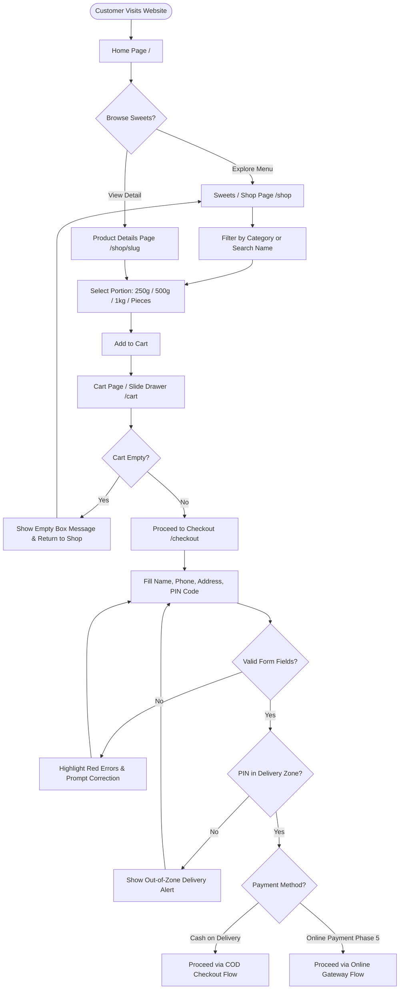
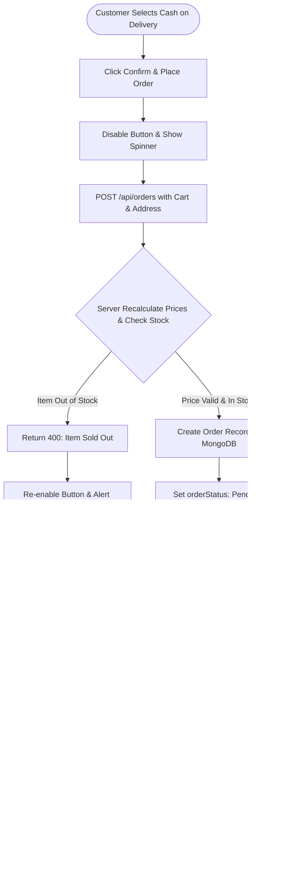
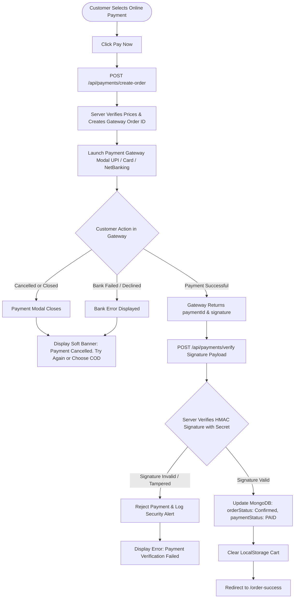
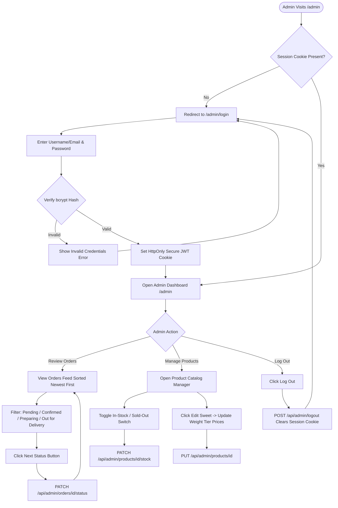

# Sangita Mithai — Application Flow Document (APP-FLOW)

**Document Version:** 1.0.0  
**Status:** Approved for Review (Phase 1: Planning & Architecture Only)  
**Author:** UI/UX Planner & Software Architect  
**Scope:** End-to-End User Journeys, Edge Cases, Decision Trees, and State Transitions  

---

## 1. Document Purpose & Beginner's Overview

This **Application Flow Document (APP-FLOW)** details every screen, user action, decision branch, and system response in the **Sangita Mithai** e-commerce website.

### 💡 Beginner's Guide to App Flows
- **User Flow:** The step-by-step path a person takes through a website to achieve a goal (for example, browsing a sweet, selecting 500g, and placing an order).
- **Happy Path:** The ideal journey where everything works smoothly without errors (e.g., customer finds sweets, enters a valid address, and order succeeds).
- **Alternative / Error Path:** What happens when something goes off-course (e.g., entered PIN code is outside the delivery area, payment card is declined, or a sweet sells out).
- **Decision Node (Branch):** A fork in the road where the system or user makes a choice (e.g., *"Did the customer choose COD or Online Payment?"*).

> ⚠️ **Implementation Notice:** No application source code has been written or modified. This document serves strictly as a planning and architectural guide.

---

## 2. Customer Application Flow

The customer journey is designed around **guest checkout** (no mandatory account creation or forced password registration required), keeping ordering fast, pleasant, and accessible for all age groups.

```
+-----------+     +------------+     +-----------------+     +-----------+
| Home Page | --> | Shop / All | --> | Product Details | --> | Cart Page |
+-----------+     +------------+     +-----------------+     +-----------+
      |                 |                                          |
      |                 +------------------------------------------+
      v                                                            v
+------------------+                                        +---------------+
| About / Contact  |                                        | Checkout Page |
+------------------+                                        +---------------+
                                                                   |
                                                                   v
                                                        +---------------------+
                                                        | Order Success Page  |
                                                        +---------------------+
                                                                   |
                                                                   v
                                                        +---------------------+
                                                        | Order Tracking Page |
                                                        +---------------------+
```

---

### 2.1 Screen 1: Home Page (`/`)

#### Step 1: Arrival & Hero Discovery
- **User Action:** Customer opens `sangitamithai.com` or lands via a shared link.
- **System Display:**
  - **Top Announcement Bar:** Saffron banner with delivery reminder (*"Fresh Sweet Delivery within City Limits | Call/WhatsApp: [Phone TBD]"*).
  - **Main Navigation Header:** Logo, links to *Shop*, *About Us*, *Contact Us*, a Search trigger icon, and a Cart pill showing current item count.
  - **Hero Banner:** High-resolution visual showcase of signature sweets in pure desi ghee with a warm vermilion background, welcoming tagline (*"Pure Desi Ghee Indian Sweets Handcrafted Daily"*), and two prominent buttons:
    - Primary CTA: **"Order Sweets Now"** (routes directly to `/shop`).
    - Secondary CTA: **"Explore Festive Hampers"** (scrolls to Gift Boxes or routes to `/shop?category=gift-boxes`).

#### Step 2: Featured Sweets & Value Highlights
- **User Action:** Customer scrolls down the homepage.
- **System Display:**
  - **Trust Badges:** *"100% Pure Desi Ghee"*, *"Prepared Fresh Every Morning"*, *"Zero Chemical Preservatives"*, *"Hygienic Kitchen"*.
  - **Signature Sweets Section:** 4 curated cards (e.g., *Kaju Katli, Motichoor Ladoo, Rasmalai, Shahi Gulab Jamun*) with quick "Add" buttons.
  - **Category Showcase:** Visual tiles for each of the 5 categories (Milk Sweets, Bengali Sweets, Dry Fruit Sweets, Traditional Mithai, Gift Boxes). Clicking any tile navigates to `/shop?category=[slug]`.
  - **Customer Testimonials & Footer:** Highlights authentic customer feedback, shop timing placeholders (*TBD*), and footer links.

---

### 2.2 Screen 2: Sweets / Shop Page (`/shop`)

#### Step 1: Catalog Navigation & Filtering
- **User Action:** Customer views the catalog of all **13 planned sweets**:
  1. Kaju Katli
  2. Gulab Jamun
  3. Rasgulla
  4. Rasmalai
  5. Motichoor Ladoo
  6. Besan Ladoo
  7. Milk Cake
  8. Peda
  9. Barfi
  10. Soan Papdi
  11. Jalebi
  12. Dry Fruit Mithai
  13. Mithai Gift Boxes
- **Category Filter Tabs:**
  - Customer clicks a category pill: `[All]`, `[Milk Sweets]`, `[Bengali Sweets]`, `[Dry Fruit Sweets]`, `[Traditional Mithai]`, `[Gift Boxes]`.
  - **System Response:** The grid updates instantly (client-side filter in < 100ms) without a full page refresh.

#### Step 2: Search Box Interaction
- **User Action:** Customer types into the search box (e.g., *"ladoo"*).
- **System Response:**
  - Input is debounced by 250ms.
  - Cards matching *"ladoo"* in title, tags, or description are shown (*Motichoor Ladoo*, *Besan Ladoo*).
  - If no sweets match, an empty state message displays: *"No sweets found matching '[query]'. Try searching for Kaju, Jamun, or Ladoo."* with a **"Clear Search"** button.

#### Step 3: Quick Portion Selection & Add to Cart
- **Card Elements:**
  - 1:1 appetizing image, vegetarian emblem (green dot & square), sweet name, short description.
  - **Portion Selector Pills:** Displays available selling options (e.g., `[ 250g ]  [ (500g) ]  [ 1kg ]` or `[ 4 pcs ]  [ 8 pcs ]`).
  - Tapping a different pill updates the card price immediately.
  - **"Add to Cart" Button:** Clicking adds 1 unit of that sweet in the chosen portion to the cart.
  - **Visual Feedback:** A gentle bounce animation occurs on the cart icon, the cart badge counter increments, and a toast message appears (*"Added 500g Kaju Katli to your box"*).

---

### 2.3 Screen 3: Product Details Page (`/shop/[slug]`)

#### Step 1: Deep Product Inspection
- **User Action:** Customer clicks on a sweet card (e.g., clicking *"Royal Kesar Rasmalai"*).
- **System Display:**
  - **Breadcrumbs:** `Home > Bengali Sweets > Royal Kesar Rasmalai`.
  - **Image Gallery:** Large main photo with thumbnail previews.
  - **Culinary Description:** Detailed narrative about ingredients, preparation method, and flavor notes.
  - **Ingredients & Allergen Info:** Clear listing (e.g., *"Fresh Chhena, Full Cream Milk, Kashmiri Kesar, Pistachios, Cardamom"*).
  - **Storage & Shelf-Life Advice:** Notice advising consumption timeframe (e.g., *"Refrigerate immediately. Best consumed within 24–48 hours."*).

#### Step 2: Portion Selection & Quantity Stepper
- **Portion Selection:** Radio buttons for configurable options (e.g., `250g (4 pcs) - ₹240`, `500g (8 pcs) - ₹460`, `1kg (16 pcs) - ₹880`).
- **Quantity Stepper:** `[ - ]  [ 1 ]  [ + ]` allows setting quantity from 1 to 20 units.
- **Subtotal Indicator:** Dynamic line total preview (`₹460 × 2 = ₹920`).
- **Action Buttons:**
  - **"Add to Sweet Box"**: Adds item and opens the Cart slide-out drawer.
  - **"Continue Shopping"**: Keeps customer on the page or takes them back to `/shop`.

---

### 2.4 Screen 4: Cart Page (`/cart`) & Slide-Out Drawer

#### Step 1: Cart Access
- **User Action:** Customer clicks the cart pill in the header, or adds an item triggering the slide-out drawer.
- **System Display:**
  - List of all selected sweets.
  - For each item:
    - Thumbnail photo.
    - Sweet name and chosen portion badge (e.g., `500g`).
    - Unit price (e.g., `₹620`).
    - Quantity stepper `[-] [2] [+]`.
    - Line total (`₹1,240`).
    - Remove icon (trash / X).

#### Step 2: In-Cart Modifications
- **Updating Quantity:** Clicking `[+]` increments count and recalculates the subtotal immediately. Clicking `[-]` decrements count. If count drops to 0, a prompt confirms removal.
- **Removing Item:** Clicking remove drops the line item with a smooth slide-out transition and recalculates totals.
- **Order Price Breakdown:**
  - Item Subtotal: `₹1,240`
  - Delivery Charge: `FREE` (or `₹40` if below threshold; *TBD by owner*).
  - **Estimated Grand Total:** `₹1,240`
- **Actions:**
  - Secondary: **"Add More Sweets"** (returns to `/shop`).
  - Primary: **"Proceed to Checkout"** (navigates to `/checkout`).

---

### 2.5 Screen 5: Checkout Page (`/checkout`)

#### Step 1: Checkout Form Completion
- **Customer Information Fields:**
  1. **Full Name:** Required, min 2 characters.
  2. **Phone Number:** Required, strictly 10 digits (pre-filled with `+91`).
  3. **Street Address / House No:** Required street and flat/house number.
  4. **Landmark:** Optional landmark for delivery assistance.
  5. **City:** Required delivery city name (*TBD default*).
  6. **PIN Code:** Required 6-digit Indian postal code.
  7. **Delivery Instructions:** Optional notes (e.g., *"Handle with care, keep box flat"*, *"Deliver before 6 PM"*).

#### Step 2: Delivery Zone Check
- **System Action (On PIN Code Blur / Submit):**
  - System checks the entered 6-digit PIN code against approved delivery zones (`SHOP_ALLOWED_PINCODES`).
  - **Success:** Green checkmark icon displayed (*"Delivery available in your area"*).
  - **Failure:** Red alert banner displayed (*"We currently deliver sweets only within selected local PIN codes. Please check your address or contact the shop."*). The "Place Order" button remains disabled until a valid PIN is entered.

#### Step 3: Payment Method Selection
- **Option A: Cash on Delivery (COD)** (Default, active at launch).
  - Helper note: *"Pay cash to our delivery executive when your fresh sweet box arrives at your doorstep."*
- **Option B: Online Payment (UPI / Cards / Net Banking)** (Marked as Phase 5 / Coming Soon).
  - Helper note: *"Secure instant online payment powered by licensed Indian payment gateways."*

#### Step 4: Submission Action
- **User Action:** Customer clicks **"Confirm & Place Order"**.
- **System Action:**
  - Client-side checks pass.
  - Submit button shows a loading spinner and disables clicks to prevent double-submissions.
  - Sends payload to backend `/api/orders`.

---

### 2.6 Screen 6: Order Confirmation / Success Page (`/order-success`)

#### Step 1: Server Validation Prerequisite
- **CRITICAL RULE:** This page is displayed **only** after the server has successfully created the order record in the database.
- For Online Payments (Phase 5), this screen is shown **only** after the server has cryptographically verified the gateway payment signature. Frontend payment return parameters alone are **never** treated as proof of payment.

#### Step 2: Confirmation Display
- **Visual Presentation:** Festive golden border, green checkmark, warm celebratory copy (*"Dhanyavaad! Your order has been placed successfully."*).
- **Order Reference ID:** Prominent code (e.g., `#SM-1042`).
- **Summary Information:**
  - Customer name and delivery address.
  - Items list with chosen portions.
  - Payment method: `Cash on Delivery (₹1,240 to collect)`.
  - Estimated preparation & delivery window (*e.g., 60–90 minutes; TBD by owner*).
  - Shop contact telephone and WhatsApp link for urgent inquiries (*TBD*).
- **Navigation CTAs:**
  - **"Track Your Order"** (navigates to `/track-order?id=SM-1042`).
  - **"Return to Home"** (navigates to `/`).
- **Cart Reset:** Browser cart is cleared from `localStorage` immediately upon successful order confirmation.

---

### 2.7 Screen 7: Order Status / Tracking Page (`/track-order`)

#### Step 1: Secure Order Lookup
- To ensure **customer privacy** and prevent strangers from guessing sequential order IDs:
  - User enters **Order Reference ID** (e.g., `SM-1042`).
  - User enters matching **10-Digit Mobile Phone Number**.
  - Clicking **"Track Order"** sends a verification request to `/api/orders/track`.

#### Step 2: Order Progress Tracking
If credentials match, the customer sees the current order status along a visual **5-Milestone Progress Stepper**:

```
[1. Order Placed] ===> [2. Confirmed] ===> [3. Preparing] ===> [4. Out for Delivery] ===> [5. Delivered]
       (Done)                (Done)              (Active)               (Pending)               (Pending)
```

- **Status Definitions:**
  1. `Pending`: Order received; kitchen reviewing incoming order.
  2. `Confirmed`: Shop accepted the order and reserved fresh stock.
  3. `Preparing`: Fresh sweets are being weighed, packed, and boxed in food-grade packaging.
  4. `Out for Delivery`: Delivery rider is en route to the customer address.
  5. `Delivered`: Sweets safely handed over and COD cash collected.
  6. `Cancelled`: If cancelled by shop or customer, displays a clear cancellation note with reason.

#### Step 3: Privacy Masking
- The customer address is displayed with partial masking (e.g., *"H.No. 45, Kr**** He****, Local City, PIN: 110001"*).
- No other customer's order history or personal details are exposed.

---

### 2.8 Screen 8 & 9: Secondary Pages (`/about` & `/contact`)

- **About Us (`/about`):**
  - Brand story of Sangita Mithai, heritage kitchen traditions, purity promise (100% vegetarian, pure desi cow ghee), and hygiene standards.
  - Includes a direct CTA button: **"Explore Our Sweets"**.
- **Contact Us (`/contact`):**
  - Physical shop address placeholder (*TBD*).
  - Telephone and WhatsApp click-to-chat links (*TBD*).
  - Shop opening hours placeholder (*e.g., 9:00 AM – 9:30 PM; TBD*).
  - Simple inquiry form (Name, Phone, Message) for wedding or bulk corporate inquiries.
  - Google Map location placeholder (*TBD*).

---

## 3. Owner / Admin Application Flow

The Admin Dashboard is an **owner-only portal** completely separated from public storefront activities. Ordinary customers have zero access to administrative views or controls.

```
+--------------------+     +-------------------+     +-------------------------+
| Admin Login Screen | --> |  Admin Dashboard  | --> | Order Management Table  |
|   (/admin/login)   |     |     (/admin)      |     +-------------------------+
+--------------------+     +-------------------+                  |
                                     |                            v
                                     |               +-------------------------+
                                     |               | Update Status Dropdown  |
                                     |               +-------------------------+
                                     v
                           +-------------------+
                           | Product Manager   |
                           | (Price/Stock Edit)|
                           +-------------------+
```

---

### 3.1 Step 1: Secure Admin Login (`/admin/login`)
- **Route:** `/admin/login`.
- **Form Fields:** Username/Email and Password.
- **Security Protections:**
  - Rate limiting (max 5 failed attempts per IP per 15 minutes).
  - Passwords are verified against salted `bcrypt` hashes on the server.
  - On success, the server sets a cryptographically signed JWT inside an `HttpOnly`, `Secure`, `SameSite=Strict` cookie (`sm_admin_session`).
  - Redirects immediately to `/admin`.
- **Failure:** Shows a generic error message: *"Invalid username or password"*.

---

### 3.2 Step 2: Admin Dashboard Overview (`/admin`)
- **Route:** `/admin` (Protected by Next.js Edge Middleware; unauthorized visits redirect to `/admin/login`).
- **Dashboard Summary Cards:**
  1. **Today's Orders:** Total number of orders placed today.
  2. **Pending Actions:** Number of orders waiting in `Pending` status.
  3. **Today's Revenue:** Total ₹ value of confirmed and delivered orders today.
  4. **Active Sweets:** Number of sweets currently marked *In Stock*.
- **Quick Navigation Tabs:**
  - **Orders Tab** (Default view).
  - **Products / Menu Tab**.
  - **Logout Button**.

---

### 3.3 Step 3: View & Manage Customer Orders
- **Order Feed:** Displays all orders sorted in reverse chronological order (newest first).
- **Status Filter Chips:** `[All]`, `[Pending]`, `[Confirmed]`, `[Preparing]`, `[Out for Delivery]`, `[Delivered]`, `[Cancelled]`.
- **Order Row Details:**
  - Order Reference ID (`#SM-1042`).
  - Time elapsed (*"5 minutes ago"*).
  - Customer Name & Phone number with one-click click-to-call.
  - Delivery Address & Landmark.
  - Ordered Items (e.g., `2x Kaju Katli (500g), 1x Rasmalai (250g)`).
  - Total Order Amount & Payment Mode (`COD - ₹1,420`).
  - Delivery notes or special instructions.

---

### 3.4 Step 4: Advance Order Status
The owner advances order fulfillment with single-click actions:

```
[ Pending ] ---> Click "Accept Order" ---> [ Confirmed ]
                                                |
                                                v
                                         Click "Start Preparing"
                                                |
                                                v
                                          [ Preparing ]
                                                |
                                                v
                                         Click "Dispatch Order"
                                                |
                                                v
                                       [ Out for Delivery ]
                                                |
                                                v
                                         Click "Mark Delivered"
                                                |
                                                v
                                          [ Delivered ]
```

- If an order must be cancelled (e.g., customer unreachable or kitchen ran out of fresh stock), the owner clicks **"Cancel Order"**, enters a reason, and status updates to `Cancelled`.

---

### 3.5 Step 5: Product Catalog & Price Management
- **Menu Tab:** Lists all 13 sweets in the catalog.
- **Stock Availability Switch:** A prominent toggle switch next to each sweet allows the owner to mark an item as **In Stock** or **Sold Out** in 1 second.
- **Price & Portion Editing:**
  - Owner can click **"Edit Sweet"** on any product.
  - Modal opens showing:
    - Sweet Name & Category.
    - Description.
    - Configurable Portion Options (e.g., modifying 250g price from ₹320 to ₹340).
    - Image selection or replacement.
  - Clicking **"Save Changes"** writes updates directly to MongoDB.

---

### 3.6 Step 6: Secure Admin Logout
- **User Action:** Owner clicks **"Log Out"** in the top navigation.
- **System Action:**
  - Sends request to `/api/admin/logout`.
  - Server clears the `sm_admin_session` cookie with an immediate expiration date.
  - Browser redirects back to `/admin/login`.
  - Browser back-button cannot view cached dashboard data.

---

## 4. Alternative & Error Flows (Edge Cases & Resilience)

| Scenario / Edge Case | System Detection & Trigger | Customer / System Experience | Resolution Path |
| :--- | :--- | :--- | :--- |
| **Empty Cart** | Customer navigates to `/cart` or opens drawer with 0 items. | Shows empty brass thali illustration: *"Your sweet box is empty! Add some fresh ladoos or kaju katli."* Checkout button is hidden/disabled. | Customer clicks **"Browse Sweets"** and is directed to `/shop`. |
| **Product Becomes Unavailable** | Product marked `isAvailable: false` by owner while customer is browsing or has it in cart. | Product card displays a prominent **"Sold Out"** badge and disables "Add to Cart". If already in cart at checkout, server rejects order with: *"Kaju Katli is currently sold out. Please remove it to proceed."* | Customer removes sold-out item from cart and continues. |
| **Form Validation Failure** | Missing full name, invalid phone (< 10 digits or non-Indian prefix), empty address, or invalid 5-digit PIN. | Relevant input field receives a red border and helper error text (e.g., *"Please enter a valid 10-digit mobile number"*). Form does not submit. | Customer corrects the specific field; error clears on next keystroke. |
| **Out-of-Zone Delivery PIN Code** | Customer enters a PIN code not included in `SHOP_ALLOWED_PINCODES`. | Red alert banner appears: *"We currently deliver sweets only within selected local PIN codes. Please check your PIN code or contact the shop."* Checkout button is disabled. | Customer changes PIN to an approved local address, or calls shop for special assistance. |
| **Online Payment Failure or Cancellation (Phase 5)** | Customer closes gateway payment popup or transaction is declined by bank. | Gateway modal closes. Checkout page displays soft warning banner: *"Payment was not completed or was cancelled. Your sweet box is saved. Please try again or choose Cash on Delivery."* | Customer retries payment or selects **Cash on Delivery** instead. |
| **Pending / Asynchronous Payment Verification (Phase 5)** | Customer's bank debits amount, but gateway response is delayed by network lag. | System displays waiting screen: *"Confirming your payment with your bank... Please do not refresh."* Server polls gateway status or waits for webhook confirmation. | Once server verifies gateway signature, order moves to `Confirmed` and redirects to `/order-success`. If timeout occurs, customer is given reference ID to contact support. |
| **Double Clicks & Page Refresh Protection (Idempotency)** | Customer rapidly clicks "Place Order" multiple times, or refreshes page during checkout submission. | Submit button is immediately disabled and displays a spinning loader upon first click. Server uses client submission tokens to prevent duplicate order records. | Single order is created; customer seamlessly lands on confirmation page once. |
| **Server or Database Unavailable** | Database connection timeout or unexpected 500 error during order placement. | Polite notification banner: *"Our sweet shop server is experiencing a momentary pause. Your cart is safe. Please try placing your order again in a moment, or call our shop directly."* | Error is logged to server console. Customer can retry safely without data corruption. |
| **Unauthorized Admin Route Access** | Non-admin user attempts to open `/admin` or call `/api/admin/*`. | Next.js Edge Middleware intercepts request. Browser requests are redirected to `/admin/login`. API requests receive HTTP 401 Unauthorized. | Dashboard remains completely hidden from unauthorized visitors. |
| **Unauthorized Order Snooping** | Stranger tries guessing `/api/orders/track` with random order IDs. | Endpoint strictly requires both `orderNumber` AND `phone`. If phone does not match order record, server returns generic `404 Order Not Found`. | No customer names, phone numbers, or addresses are ever disclosed to unauthorized parties. |

---

## 5. Flow Diagrams

### 5.1 Customer Shopping & Checkout Flow



---

### 5.2 Cash on Delivery (COD) Checkout Flow



---

### 5.3 Online Payment & Server Verification Flow (Phase 5)



---

### 5.4 Admin Order & Product Management Flow



---

## 6. Site Navigation & Information Architecture Map

```
+---------------------------------------------------------------------------------------------------------+
|                                        GLOBAL HEADER NAVIGATION                                         |
|  [Logo: Sangita Mithai]    [Home]    [Shop Sweets]    [About Us]    [Contact Us]    [🔍]    [🛒 Cart]   |
+---------------------------------------------------------------------------------------------------------+
       |                           |                |              |                    |          |
       v                           v                v              v                    v          v
   +-------+                  +---------+      +----------+   +----------+          +-------+  +--------+
   | Home  |                  | Shop    |      | About Us |   | Contact  |          |Search |  | Cart   |
   | Page  |                  | Catalog |      | Page     |   | Page     |          | Modal |  | Drawer |
   +-------+                  +---------+      +----------+   +----------+          +-------+  +--------+
       |                           |                                                               |
       |                           v                                                               v
       |                      +---------+                                                     +----------+
       |                      | Product | --------------------------------------------------> | Checkout |
       |                      | Details |                                                     | Page     |
       |                      +---------+                                                     +----------+
       |                                                                                           |
       |                                                                                           v
       |                                                                                      +----------+
       |                                                                                      | Order    |
       |                                                                                      | Success  |
       |                                                                                      +----------+
       |                                                                                           |
       |                                                                                           v
       |                                                                                      +----------+
       +------------------------------------------------------------------------------------> | Track    |
                                                                                              | Order    |
                                                                                              +----------+

+---------------------------------------------------------------------------------------------------------+
|                                        GLOBAL FOOTER NAVIGATION                                         |
|  Brand Story  |  Quick Links (Shop, About, Contact, Track)  |  Timings (TBD)  |  Social & Legal Info   |
+---------------------------------------------------------------------------------------------------------+
|                                    MOBILE STICKY BOTTOM BAR (< 768px)                                   |
|             [🏠 Home]            [🍬 Shop]            [🛒 Cart (Badge)]            [🚚 Track]           |
+---------------------------------------------------------------------------------------------------------+
```

---

## 7. Consistency Matrix & Unresolved Decisions Log

In strict adherence to project planning guidelines, all undefined business and operational parameters are recorded below as **To Be Decided (TBD)** and will be provided by the shop owner:

| Parameter | Current Specification | Status | Resolution Milestone |
| :--- | :--- | :--- | :--- |
| **Physical Shop Address & Contact Info** | Generic placeholders used in Footer and Contact page. | **TBD by owner** | Phase 3 (Storefront pages) |
| **Delivery City & Allowed PIN Codes** | Configured via `SHOP_DELIVERY_CITY` and `SHOP_ALLOWED_PINCODES` env variables. | **TBD by owner** | Phase 5 (Real Orders) |
| **Delivery Charges & Free Delivery Threshold** | Planned logic: ₹0 if subtotal ≥ threshold, else standard fee. Specific ₹ amounts to be confirmed. | **TBD by owner** | Phase 5 (Real Orders) |
| **Minimum Order Amount** | Configured via `SHOP_MIN_ORDER_AMOUNT` env variable. | **TBD by owner** | Phase 5 (Real Orders) |
| **Customer Accounts vs. Guest Checkout** | Guest checkout is specified by default for speed; customer registration is deferred. | **TBD / Deferred** | Future Roadmap |
| **Online Payment Gateway Provider** | Interface designed; selection between Razorpay, Cashfree, or PhonePe. | **TBD by owner** | Phase 5 (Real Orders) |
| **Customer Notification Service** | SMS / WhatsApp notifications not assumed or hardcoded. | **TBD by owner** | Phase 5 (Real Orders) |
| **Production Hosting Environment** | Requirements specified (Node.js 18+, HTTPS, MongoDB Atlas); host choice. | **TBD by owner** | Phase 6 (Deployment) |
