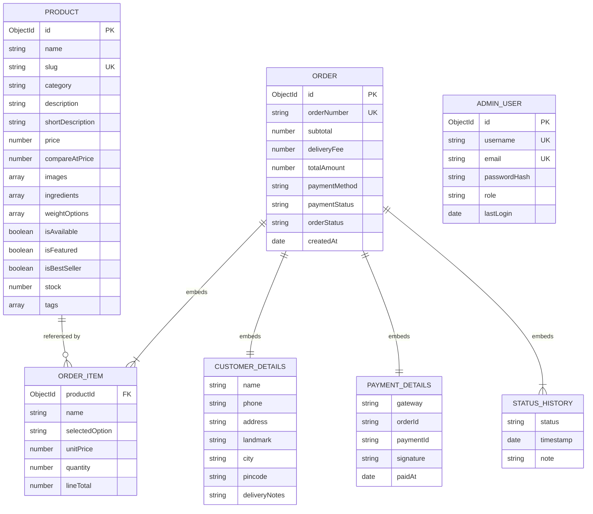
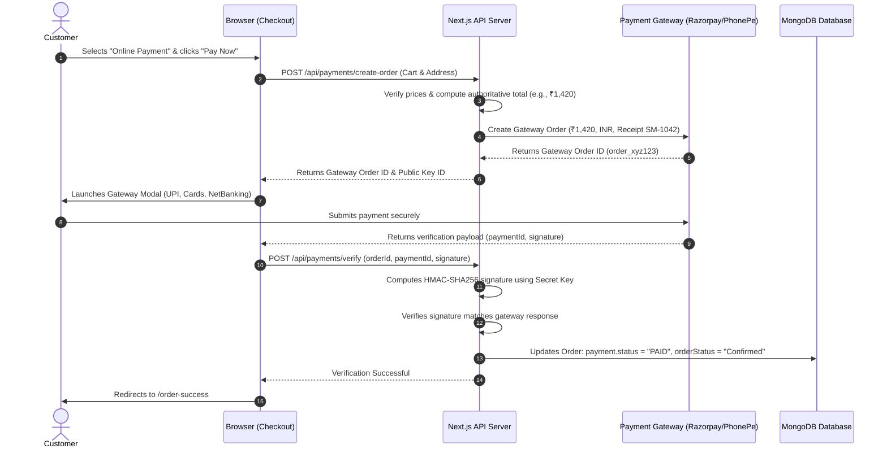

# Sangita Mithai — Backend Database Schema & Data Models

**Document Version:** 1.0.0  
**Status:** Approved for Review (Phase 1: Planning & Architecture Only)  
**Author:** Software Architect & Database Engineer  
**Scope:** MongoDB Collections, Mongoose Schemas, Relationships, Validation Rules, Security Policies, and Business Logic  

---

## 1. Document Overview & Beginner's Primer

This document defines the complete backend database architecture and data models for **Sangita Mithai (संगीता मिठाई)**, an online traditional Indian sweets store. The database is built using **MongoDB** (a flexible NoSQL document database) and **Mongoose** (an Object Data Modeling library for Node.js / Next.js).

### 💡 Beginner's Guide to Database Concepts

To make this architecture clear and accessible to non-technical stakeholders and apprentice developers, here are simple explanations of the foundational concepts used throughout:

- **Database (MongoDB):** Think of MongoDB as a digital filing cabinet. Instead of rigid spreadsheet tables with fixed columns (like SQL), MongoDB stores information as **documents** (resembling index cards in JSON format).
- **Collection:** A folder inside the database that holds similar documents. For example, the `products` collection holds all sweets, and the `orders` collection holds all customer orders.
- **Document:** A single record inside a collection. For example, one document represents *"Kaju Katli"*, containing its name, description, portion sizes, and prices.
- **Field:** A specific piece of information on a document (like a line on an index card). For example, `name`, `price`, or `pincode`.
- **Mongoose:** A software library that acts as a strict quality inspector. MongoDB itself is very flexible, so Mongoose enforces rules (e.g., *"every sweet must have a name, and prices cannot be negative"*).
- **Schema:** The blueprint created in Mongoose that defines what fields are allowed, what type of data they must hold (Text, Number, Date, Boolean), and whether they are required.
- **Embedded Document (Subdocument):** A smaller card stored directly inside a larger card. For example, an order embeds the customer's delivery address and the list of ordered sweets right inside the order document.
- **Reference (`ObjectId`):** A unique pointer connecting one card to another. For example, an order item includes a reference (`productId`) pointing back to the original sweet in the `products` collection.
- **Index:** A special internal lookup index (like the index at the back of a cookbook) that allows MongoDB to find documents in milliseconds without scanning the entire database.

> ⚠️ **Implementation Notice:** In accordance with Phase 1 project rules, no application source code has been written, no npm packages have been installed, and no live database connection has been established. This document serves strictly as an engineering specification.

---

## 2. High-Level Architecture & Relationships

### 2.1 The Two Fundamental Data Design Approaches
In MongoDB, there are two primary ways to connect related pieces of information:

1. **Embedding (Denormalization):** Storing related data directly inside a single document.
   - *When to use:* When data is accessed together, when the child data does not grow infinitely, and when capturing a historical snapshot is essential.
   - *Application in Sangita Mithai:* Customer delivery details, ordered item snapshots, and order status histories are **embedded** directly inside each `Order` document.
2. **Referencing (Normalization):** Storing documents in separate collections and linking them using unique ID pointers (`_id`).
   - *When to use:* When entities exist independently and need centralized management.
   - *Application in Sangita Mithai:* Sweets exist independently in the `products` collection so the shop owner can edit their descriptions and prices in one place. Each order item stores a reference (`productId`) pointing to the sweet, while also embedding a frozen price snapshot.

### 2.2 Visual Entity-Relationship Diagram



---

## 3. Product Catalog Schema (`products` Collection)

The `products` collection stores the catalog of handcrafted Indian sweets. It is engineered to support multiple selling methods: by **weight** (e.g., 250g, 500g, 1kg), by **pieces** (e.g., 4 pcs, 8 pcs for syrup sweets), or by **festive gift boxes**.

### 3.1 Data Dictionary for Products

| Field Name | Mongoose Type | Required | Default | Validation & Constraints | Description |
| :--- | :--- | :---: | :---: | :--- | :--- |
| `_id` | `ObjectId` | Auto | Auto | Unique 24-character hex ID | MongoDB primary key. |
| `name` | `String` | **Yes** | — | Trimmed, min 2 chars, max 100 chars | Display name of the sweet (e.g., `"Kaju Katli"`). |
| `slug` | `String` | **Yes** | — | Unique, lowercase, trimmed, URL-safe | URL slug for routing (e.g., `"kaju-katli"`). |
| `category` | `String` | **Yes** | — | Enum: `["milk-sweets", "bengali-sweets", "dry-fruit-sweets", "traditional-mithai", "gift-boxes"]` | Culinary category for shop filtering. |
| `description` | `String` | **Yes** | — | Trimmed, min 10 chars, max 2000 chars | Mouth-watering narrative describing ingredients, taste, and heritage. |
| `shortDescription`| `String` | **Yes** | — | Trimmed, max 200 chars | Concise summary displayed on product cards. |
| `price` | `Number` | **Yes** | — | Minimum: `0` | Base starting price in Indian Rupees (₹). |
| `compareAtPrice` | `Number` | No | `null` | Minimum: `0` | Optional original strikethrough MRP to show festive discounts. |
| `images` | `[String]` | **Yes** | `[]` | Must contain at least 1 image path | Array of relative photo paths (e.g., `["/images/kaju-katli.webp"]`). |
| `ingredients` | `[String]` | No | `[]` | Array of strings | Key ingredients (e.g., `["Cashews", "Sugar", "Silver Leaf"]`). |
| `weightOptions` | `[WeightOption]`| **Yes** | `[]` | Must contain at least 1 portion option | Subdocuments defining selectable portion tiers and their prices. |
| `isAvailable` | `Boolean` | No | `true` | Indexed | In-stock toggle for the shop owner (1-click Sold Out switch). |
| `isFeatured` | `Boolean` | No | `false`| Indexed | Determines whether the sweet appears in the homepage hero/featured grid. |
| `isBestSeller` | `Boolean` | No | `false`| — | Triggers display of the golden "Bestseller" ribbon on cards. |
| `stock` | `Number` | No | `50` | Minimum: `0`, Integer | Estimated inventory count for kitchen tracking. |
| `tags` | `[String]` | No | `[]` | Lowercase strings | Search keywords (e.g., `["kaju", "dry fruit", "diwali", "silver leaf"]`). |
| `rating` | `Number` | No | `4.8` | Min: `1.0`, Max: `5.0` | Social proof display rating. |
| `reviewCount` | `Number` | No | `12` | Min: `0`, Integer | Social proof review counter. |
| `createdAt` | `Date` | Auto | `Date.now`| Immutable | Timestamp of creation. |
| `updatedAt` | `Date` | Auto | `Date.now`| Auto-updated | Timestamp of last modification. |

### 3.2 Subdocument: Portion & Weight Options (`WeightOptionSchema`)

```typescript
interface IWeightOption {
  label: string;  // Portion descriptor: e.g., "250g", "500g", "1kg", "4 pcs", "1 Box"
  price: number;  // Price in INR (₹) for this specific portion tier (e.g., 320)
}
```

- **Validation Rules:**
  - `label`: Required string, trimmed, non-empty (e.g., `"500g"`).
  - `price`: Required number, strictly positive (`min: 0`).

### 3.3 Product Database Indexes
To maintain lightning-fast browsing and search performance on mobile devices:
1. **Unique Index:** `{ slug: 1 }` (ensures two sweets never share the same URL).
2. **Text Search Index:** `{ name: "text", description: "text", shortDescription: "text", tags: "text" }` (powers instant live search queries like *"ladoo"* or *"kesar"*).
3. **Filtering Compound Indexes:**
   - `{ category: 1, isAvailable: 1 }` (optimizes category browsing for available items).
   - `{ isFeatured: 1, isAvailable: 1 }` (optimizes homepage featured sweet queries).

### 3.4 Proposed Mongoose Product Schema Code Blueprint

```typescript
// Proposed Schema Blueprint for Phase 4 implementation
import { Schema, model, models } from 'mongoose';

const WeightOptionSchema = new Schema(
  {
    label: { type: String, required: true, trim: true },
    price: { type: Number, required: true, min: [0, 'Price cannot be negative'] }
  },
  { _id: false } // No separate ID needed for portion tiers
);

const ProductSchema = new Schema(
  {
    name: { type: String, required: [true, 'Sweet name is required'], trim: true },
    slug: { type: String, required: [true, 'Slug is required'], unique: true, lowercase: true, trim: true },
    category: {
      type: String,
      required: [true, 'Category is required'],
      enum: {
        values: ['milk-sweets', 'bengali-sweets', 'dry-fruit-sweets', 'traditional-mithai', 'gift-boxes'],
        message: '{VALUE} is not a valid sweet category'
      },
      index: true
    },
    description: { type: String, required: true, trim: true },
    shortDescription: { type: String, required: true, trim: true, maxlength: 200 },
    price: { type: Number, required: true, min: [0, 'Base price cannot be negative'] },
    compareAtPrice: { type: Number, default: null, min: 0 },
    images: {
      type: [String],
      validate: [(arr: string[]) => arr.length > 0, 'At least one sweet image is required'],
      default: ['/images/kaju-katli.webp']
    },
    ingredients: { type: [String], default: [] },
    weightOptions: {
      type: [WeightOptionSchema],
      validate: [(arr: any[]) => arr.length > 0, 'At least one portion option must be provided']
    },
    isAvailable: { type: Boolean, default: true, index: true },
    isFeatured: { type: Boolean, default: false, index: true },
    isBestSeller: { type: Boolean, default: false },
    stock: { type: Number, default: 50, min: 0 },
    tags: { type: [String], default: [] },
    rating: { type: Number, default: 4.8, min: 1.0, max: 5.0 },
    reviewCount: { type: Number, default: 12, min: 0 }
  },
  { timestamps: true }
);

// Compound text index for real-time sweet search
ProductSchema.index({ name: 'text', description: 'text', shortDescription: 'text', tags: 'text' });
```

---

## 4. Users & Authentication Architecture

### 4.1 Customer User Model: Guest Checkout Strategy
To eliminate purchase friction, **Sangita Mithai deliberately operates on a Guest Checkout model at launch**:
- Customers are **not** forced to create a username, memorize passwords, or complete complex email verification steps before buying sweets.
- Customer details (Full Name, 10-digit Phone, Full Street Address, City, PIN Code, Delivery Notes) are collected directly during checkout and embedded immutably inside the `Order` document.
- **Privacy Assurance:** A customer's details are attached only to their specific order record and are protected from unauthorized public viewing.

#### Future Customer Accounts (Roadmap / Phase 6+):
If the shop owner chooses to introduce customer accounts in future phases (e.g., for saved delivery addresses or festive re-ordering), a dedicated `customers` collection will be added with fields:
- `phone`: Unique 10-digit primary identifier.
- `name`: Full name.
- `savedAddresses`: Array of delivery addresses.
- `orderHistory`: Array of `ObjectId` references to `orders`.

---

### 4.2 Admin User Schema (`admins` Collection)
The `admins` collection stores credentials for the shop owner to access the private Admin Dashboard (`/admin`).

#### Data Dictionary for Admin User

| Field Name | Mongoose Type | Required | Unique | Validation & Description |
| :--- | :--- | :---: | :---: | :--- |
| `_id` | `ObjectId` | Auto | Yes | MongoDB primary key. |
| `username` | `String` | **Yes** | **Yes** | Trimmed, lowercase, alphanumeric, min 3 chars (e.g., `"sangita_owner"`). |
| `email` | `String` | **Yes** | **Yes** | Trimmed, lowercase, valid email format. |
| `passwordHash` | `String` | **Yes** | No | Salted `bcrypt` hash (cost factor: 12 rounds). **Never plaintext!** |
| `role` | `String` | **Yes** | No | Enum: `["OWNER"]`. Default: `"OWNER"`. Controls administrative privileges. |
| `lastLogin` | `Date` | No | No | Timestamp of the most recent successful admin session. |
| `createdAt` | `Date` | Auto | No | Account creation timestamp. |
| `updatedAt` | `Date` | Auto | No | Last update timestamp. |

#### Password Security & Pre-Save Hook
1. **Zero Plaintext Passwords:** Plaintext passwords are never written to the database or logged to console output.
2. **Bcrypt Hashing:** Passwords are automatically hashed using `bcryptjs` with 12 salt rounds before being stored.
3. **Data Sanitization:** The schema includes a `toJSON` transform that strips `passwordHash` from any JSON output to prevent accidental exposure in API responses.

#### Proposed Mongoose Admin Schema Code Blueprint

```typescript
// Proposed Admin Schema Blueprint for Phase 4
import { Schema, model, models } from 'mongoose';
import bcrypt from 'bcryptjs';

const AdminUserSchema = new Schema(
  {
    username: {
      type: String,
      required: [true, 'Username is required'],
      unique: true,
      lowercase: true,
      trim: true,
      minlength: [3, 'Username must be at least 3 characters']
    },
    email: {
      type: String,
      required: [true, 'Email is required'],
      unique: true,
      lowercase: true,
      trim: true,
      match: [/^\S+@\S+\.\S+$/, 'Please enter a valid email address']
    },
    passwordHash: {
      type: String,
      required: [true, 'Password hash is required']
    },
    role: {
      type: String,
      required: true,
      enum: ['OWNER'],
      default: 'OWNER'
    },
    lastLogin: { type: Date, default: null }
  },
  {
    timestamps: true,
    toJSON: {
      transform: function (doc, ret) {
        delete ret.passwordHash; // Strips hash from API outputs
        return ret;
      }
    }
  }
);

// Pre-save hook to hash password if modified
AdminUserSchema.pre('save', async function (next) {
  if (!this.isModified('passwordHash')) return next();
  const salt = await bcrypt.genSalt(12);
  this.passwordHash = await bcrypt.hash(this.passwordHash, salt);
  next();
});

// Instance method to verify password at login
AdminUserSchema.methods.comparePassword = async function (candidatePassword: string): Promise<boolean> {
  return bcrypt.compare(candidatePassword, this.passwordHash);
};
```

---

## 5. Orders & Order Items Schema (`orders` Collection)

The `orders` collection is the operational core of the platform. It records every customer purchase, snapshots sweet prices at the time of order, tracks delivery addresses, records payment states, and maintains an audit trail of fulfillment stages.

### 5.1 Subdocument: Order Item (`OrderItemSchema`)

When a customer orders sweets, the order item must capture a **frozen snapshot** of the product details at that exact moment. If the shop owner changes the price of Kaju Katli tomorrow from ₹320 to ₹350, past orders must still record that the customer paid ₹320.

| Field Name | Mongoose Type | Required | Constraints | Purpose & Description |
| :--- | :--- | :---: | :--- | :--- |
| `productId` | `ObjectId` | **Yes** | Ref: `'Product'` | Pointer to original sweet document in `products`. |
| `name` | `String` | **Yes** | Trimmed | Snapshot of sweet name (e.g., `"Kaju Katli"`). |
| `selectedOption` | `String` | **Yes** | Trimmed | Snapshot of portion label (e.g., `"500g"` or `"8 pcs"`). |
| `unitPrice` | `Number` | **Yes** | Min: `0` | Snapshot of authoritative unit price in INR (₹) at purchase time. |
| `quantity` | `Number` | **Yes** | Min: `1`, Max: `20`, Integer | Number of units ordered. |
| `lineTotal` | `Number` | **Yes** | Min: `0` | Calculated on server: `unitPrice * quantity`. |

```typescript
const OrderItemSchema = new Schema(
  {
    productId: { type: Schema.Types.ObjectId, ref: 'Product', required: true },
    name: { type: String, required: true, trim: true },
    selectedOption: { type: String, required: true, trim: true },
    unitPrice: { type: Number, required: true, min: [0, 'Unit price cannot be negative'] },
    quantity: {
      type: Number,
      required: true,
      min: [1, 'Quantity must be at least 1'],
      max: [20, 'Quantity cannot exceed 20 per item']
    },
    lineTotal: { type: Number, required: true, min: 0 }
  },
  { _id: false }
);
```

---

### 5.2 Subdocument: Customer & Delivery Details (`CustomerDetailsSchema`)

Captures the delivery address and contact information needed for local city delivery.

| Field Name | Mongoose Type | Required | Validation Pattern | Description |
| :--- | :--- | :---: | :--- | :--- |
| `name` | `String` | **Yes** | Min 2 chars, max 100 chars | Customer full name. |
| `phone` | `String` | **Yes** | Regex: `/^[6-9]\d{9}$/` | Valid 10-digit Indian mobile number starting with 6, 7, 8, or 9. |
| `address` | `String` | **Yes** | Min 5 chars, max 300 chars | House/flat number, building name, and street address. |
| `landmark` | `String` | No | Max 150 chars | Optional landmark for delivery assistance. |
| `city` | `String` | **Yes** | Trimmed | Delivery city name (*TBD default by owner*). |
| `pincode` | `String` | **Yes** | Regex: `/^\d{6}$/` | Strictly 6-digit Indian postal code. |
| `deliveryNotes` | `String` | No | Max 200 chars | Optional customer notes (e.g., *"Deliver before 5 PM"*). |

```typescript
const CustomerDetailsSchema = new Schema(
  {
    name: { type: String, required: [true, 'Customer name is required'], trim: true, minlength: 2, maxlength: 100 },
    phone: {
      type: String,
      required: [true, 'Mobile number is required'],
      trim: true,
      match: [/^[6-9]\d{9}$/, 'Please enter a valid 10-digit Indian mobile number']
    },
    address: { type: String, required: [true, 'Street address is required'], trim: true, minlength: 5, maxlength: 300 },
    landmark: { type: String, trim: true, maxlength: 150, default: '' },
    city: { type: String, required: [true, 'City is required'], trim: true },
    pincode: {
      type: String,
      required: [true, 'PIN code is required'],
      trim: true,
      match: [/^\d{6}$/, 'PIN code must be exactly 6 digits']
    },
    deliveryNotes: { type: String, trim: true, maxlength: 200, default: '' }
  },
  { _id: false }
);
```

---

### 5.3 Subdocument: Payment Details (`PaymentDetailsSchema`)

Records payment method, status, and verification tokens.

| Field Name | Mongoose Type | Required | Allowed Values / Constraints | Description |
| :--- | :--- | :---: | :--- | :--- |
| `method` | `String` | **Yes** | Enum: `["COD", "ONLINE"]` | Payment method chosen at checkout. Default: `"COD"`. |
| `status` | `String` | **Yes** | Enum: `["PENDING", "PAID", "FAILED"]` | Payment status. Default: `"PENDING"`. |
| `gateway` | `String` | No | `null` or e.g., `"RAZORPAY"`, `"PHONEPE"` | Payment gateway provider (*TBD by owner for Phase 5*). |
| `gatewayOrderId` | `String` | No | `null` | Order reference ID created by the payment gateway. |
| `gatewayPaymentId`| `String` | No | `null` | Successful transaction ID returned by the payment gateway. |
| `gatewaySignature`| `String` | No | `null` | Cryptographic signature string verified by the server. |
| `paidAt` | `Date` | No | `null` | Timestamp when payment was verified. |

```typescript
const PaymentDetailsSchema = new Schema(
  {
    method: {
      type: String,
      required: true,
      enum: ['COD', 'ONLINE'],
      default: 'COD'
    },
    status: {
      type: String,
      required: true,
      enum: ['PENDING', 'PAID', 'FAILED'],
      default: 'PENDING'
    },
    gateway: { type: String, default: null },
    gatewayOrderId: { type: String, default: null },
    gatewayPaymentId: { type: String, default: null },
    gatewaySignature: { type: String, default: null },
    paidAt: { type: Date, default: null }
  },
  { _id: false }
);
```

---

### 5.4 Subdocument: Order Status History (`StatusHistorySchema`)

Provides a transparent, auditable history of fulfillment milestones:

| Field Name | Mongoose Type | Required | Description |
| :--- | :--- | :---: | :--- |
| `status` | `String` | **Yes** | Enum: `["Pending", "Confirmed", "Preparing", "Out for Delivery", "Delivered", "Cancelled"]`. |
| `timestamp` | `Date` | **Yes** | Time when this status transition occurred. Default: `Date.now`. |
| `note` | `String` | No | Optional note (e.g., *"Accepted by kitchen"*, *"Out with delivery rider Raju"*). |

```typescript
const StatusHistorySchema = new Schema(
  {
    status: {
      type: String,
      required: true,
      enum: ['Pending', 'Confirmed', 'Preparing', 'Out for Delivery', 'Delivered', 'Cancelled']
    },
    timestamp: { type: Date, default: Date.now },
    note: { type: String, trim: true, default: '' }
  },
  { _id: false }
);
```

---

### 5.5 Master Order Schema (`OrderSchema`)

Combines all subdocuments into the primary `orders` collection:

| Field Name | Mongoose Type | Required | Indexed | Description |
| :--- | :--- | :---: | :---: | :--- |
| `_id` | `ObjectId` | Auto | Yes | MongoDB primary key. |
| `orderNumber` | `String` | **Yes** | **Unique** | Friendly human-readable identifier (e.g., `"SM-1042"`). |
| `customer` | `CustomerDetails`| **Yes** | Compound | Embedded customer delivery and contact details. |
| `items` | `[OrderItem]` | **Yes** | No | Array of ordered sweets with frozen price snapshots. |
| `subtotal` | `Number` | **Yes** | No | Sum of all line item totals calculated on server. |
| `deliveryFee` | `Number` | **Yes** | No | Applied delivery fee in INR (₹0 or configured rate). |
| `totalAmount` | `Number` | **Yes** | No | Final payable amount: `subtotal + deliveryFee`. |
| `payment` | `PaymentDetails` | **Yes** | No | Payment method, status, and gateway audit details. |
| `orderStatus` | `String` | **Yes** | Yes | Current fulfillment status: `Pending` → `Confirmed` → `Preparing` → `Out for Delivery` → `Delivered` (or `Cancelled`). |
| `cancellationReason`| `String`| No | No | Reason recorded if order is cancelled. |
| `statusHistory` | `[StatusHistory]`| No | No | Audit timeline of all milestone updates. |
| `createdAt` | `Date` | Auto | Yes | Order placement timestamp. |
| `updatedAt` | `Date` | Auto | No | Last status update timestamp. |

### 5.6 Order Database Indexes
1. **Unique Order Reference Index:** `{ orderNumber: 1 }` (ensures order numbers are unique and enables instant lookup).
2. **Customer Privacy Tracking Index:** `{ orderNumber: 1, "customer.phone": 1 }` (powers the dual-credential `/track-order` verification).
3. **Admin Dashboard Order Listing Index:** `{ orderStatus: 1, createdAt: -1 }` (allows the owner to quickly view active orders sorted by newest first).
4. **General Reverse Chronological Index:** `{ createdAt: -1 }` (speeds up sales reporting).

### 5.7 Proposed Mongoose Master Order Schema Code Blueprint

```typescript
// Proposed Master Order Schema Blueprint for Phase 4
import { Schema, model, models } from 'mongoose';

const OrderSchema = new Schema(
  {
    orderNumber: {
      type: String,
      required: [true, 'Order number is required'],
      unique: true,
      uppercase: true,
      trim: true,
      index: true
    },
    customer: { type: CustomerDetailsSchema, required: true },
    items: {
      type: [OrderItemSchema],
      validate: [(arr: any[]) => arr.length > 0, 'Order must contain at least one sweet item']
    },
    subtotal: { type: Number, required: true, min: [0, 'Subtotal cannot be negative'] },
    deliveryFee: { type: Number, required: true, min: [0, 'Delivery fee cannot be negative'], default: 0 },
    totalAmount: { type: Number, required: true, min: [0, 'Total amount cannot be negative'] },
    payment: { type: PaymentDetailsSchema, required: true },
    orderStatus: {
      type: String,
      required: true,
      enum: {
        values: ['Pending', 'Confirmed', 'Preparing', 'Out for Delivery', 'Delivered', 'Cancelled'],
        message: '{VALUE} is not a valid order status'
      },
      default: 'Pending',
      index: true
    },
    cancellationReason: { type: String, trim: true, default: null },
    statusHistory: { type: [StatusHistorySchema], default: [] }
  },
  { timestamps: true }
);

// Compound index for secure order tracking verification
OrderSchema.index({ orderNumber: 1, 'customer.phone': 1 });

// Compound index for admin order dashboard feed
OrderSchema.index({ orderStatus: 1, createdAt: -1 });
```

---

## 6. Critical Business Rules & Data Integrity

To prevent fraud, pricing errors, and order discrepancies, the backend enforces the following **5 Golden Business Rules**:

### Rule 1: Authoritative Server-Side Price Calculation
- **The Golden Rule:** The browser/client is **never** trusted for product prices, item discounts, delivery fees, or order totals.
- **Enforcement:**
  1. When the client sends `POST /api/orders` with cart items:
  2. For every item, the server reads the true sweet document from the database using `productId`.
  3. The server locates the specific `selectedOption` (e.g., `"500g"`) in `product.weightOptions`.
  4. The server reads the authoritative `option.price` directly from the database record.
  5. The server calculates: `lineTotal = option.price * quantity`.
  6. The server sums all line totals to compute `subtotal`.
  7. The server calculates `deliveryFee` according to shop rules.
  8. The server sets `totalAmount = subtotal + deliveryFee`.
  9. If the client submitted a tampered total, it is silently ignored and overwritten by the server's calculation.

### Rule 2: Price Freezing (Historic Snapshot Preservation)
- Product prices change over time due to seasonal fluctuations in ghee, cashews, and milk costs.
- When an order is placed, the sweet name, portion label, and unit price are saved directly into `Order.items`.
- Future updates to `Product.price` or `Product.weightOptions` will **never** alter existing order records or historical sales totals.

### Rule 3: Stock Availability & In-Stock Guard
- Before creating an order, the server checks `product.isAvailable`.
- If `isAvailable === false`, the order is rejected immediately with HTTP 400: *"Kaju Katli is currently sold out. Please remove it from your box to proceed."*

### Rule 4: Quantity Boundaries
- Each line item enforces a minimum quantity of **1** and a maximum quantity of **20** units.
- This prevents negative quantities (which could manipulate order totals into negative amounts) and protects the sweet shop kitchen from accidental unrealistic order sizes without prior wholesale consultation.

### Rule 5: Delivery Zone Verification (PIN Code Guard)
- The server checks `customer.pincode` against the shop's approved delivery zone list (`SHOP_ALLOWED_PINCODES` in `.env.local`).
- If outside the local city zone, the order is rejected with an informative notice: *"We currently deliver sweets only within selected local PIN codes. Please check your PIN code or contact our shop directly."*

---

## 7. Security Architecture & Sensitive Data Protection

### 7.1 Absolute Prohibition on Plaintext Passwords
- All passwords are encrypted with `bcrypt` using 12 salt rounds before being stored in the database.
- Even if the database is read directly, password hashes cannot be reversed back into plaintext passwords.

### 7.2 Zero Storage of Card Numbers & CVVs
- **Strict Compliance:** The Sangita Mithai website and database will **never** accept, handle, process, transmit, or store:
  - 16-digit credit/debit card numbers (PAN).
  - Card expiry dates.
  - 3-digit or 4-digit CVV/CVC security codes.
  - Net banking passwords or UPI PINs.
- **Payment Gateway Delegation:** When online payments are activated (Phase 5), all card input is processed inside the payment gateway's secure, PCI-DSS Level 1 compliant iframe or SDK (e.g., Razorpay / PhonePe). The database only stores non-sensitive transaction tokens (`gatewayPaymentId`).

### 7.3 Customer Privacy & Tracking Protection
- **No Sequential Guessing:** Order tracking (`/api/orders/track`) strictly requires **both** `orderNumber` (e.g., `SM-1042`) and the matching `phone` number.
- If the phone number does not match the order record, the server returns a generic `404 Not Found` response. This prevents strangers from guessing order numbers to discover customer names and addresses.
- Public tracking responses return **masked addresses** (e.g., *"Flat 302, Kr**** He****, Local City, PIN: 110001"*).

### 7.4 Input Sanitization & NoSQL Injection Prevention
- All user-supplied string fields (`name`, `address`, `deliveryNotes`, `orderNumber`) are trimmed and sanitized.
- Mongoose schema typing automatically prevents MongoDB query injection operators (such as `$gt`, `$ne`, or `$where`) from executing in queries.

---

## 8. Payment Flow & Future Online Gateway Considerations

### 8.1 Phase 1–4 Launch: Cash on Delivery (COD) Focus
Cash on Delivery is the foundational payment model for local sweets shops:
1. Customer selects **Cash on Delivery (COD)** on checkout.
2. Server validates items, computes `totalAmount`, and saves the order with:
   - `payment.method: "COD"`
   - `payment.status: "PENDING"`
   - `orderStatus: "Pending"`
3. Customer receives their Order Reference ID (e.g., `#SM-1042`).
4. Shop owner accepts the order, kitchen prepares fresh sweets, and delivery executive delivers the box.
5. Delivery executive collects cash at the doorstep.
6. Shop owner marks order as `Delivered` and updates payment status to `PAID` in the Admin Dashboard.

---

### 8.2 Phase 5: Future Online Payment Gateway Architecture
When the shop owner decides to enable digital payments (UPI, Credit/Debit cards, Net Banking):



#### Cryptographic Verification Requirements for Online Payments:
1. **Never mark paid on client feedback alone:** An order is marked `PAID` **only** after the backend verifies the cryptographic HMAC-SHA256 signature using the gateway secret key stored in `.env.local`.
2. **Server-to-Server Webhook:** An idempotent webhook endpoint (`POST /api/payments/webhook`) will be provided to capture cases where a customer closes their browser before the redirect completes.

---

## 9. Undecided Business Parameters & Decision Log (Marked as TBD)

In accordance with project planning instructions, all business variables that depend on the physical sweet shop are marked as **To Be Decided (TBD)** and will be finalized with the shop owner before Phase 5:

| Open Business Parameter | Database / Schema Impact | Current Planning Treatment | Status |
| :--- | :--- | :--- | :--- |
| **Physical Shop Address & Phone** | Informational display on receipts and Contact page. | Generic placeholders used in mock data. | **TBD by owner** |
| **Eligible Delivery PIN Codes** | PIN validation in checkout and order creation. | Managed via `SHOP_ALLOWED_PINCODES` environment variable. | **TBD by owner** |
| **Delivery Charges & Free Delivery Threshold** | `deliveryFee` calculation logic in Order creation. | Placeholder logic: ₹40 standard fee, Free for orders above ₹500. | **TBD by owner** |
| **Minimum Order Value** | Validation rule on order creation. | Configured via `SHOP_MIN_ORDER_AMOUNT` (e.g., ₹150 placeholder). | **TBD by owner** |
| **Online Payment Gateway Provider** | `payment.gateway` enum and SDK integration. | Interface designed; choice between Razorpay, Cashfree, or PhonePe. | **TBD by owner** |
| **Shop Operating Hours & Delivery Cutoff** | Time validation for same-day delivery orders. | Placeholder: 9:00 AM – 9:30 PM daily. | **TBD by owner** |

---

## 10. Summary Checklist of Schemas & Entities

- [x] **Products Collection (`products`):** Sweet name, slug, descriptions, images, category enum, portion tiers with prices (`weightOptions`), stock count, availability toggle, tags, and text search indexes.
- [x] **Admins Collection (`admins`):** Username, email, salted `bcrypt` password hash, OWNER role, pre-save hashing hook, and JSON sanitization.
- [x] **Orders Collection (`orders`):** Unique human-readable `orderNumber`, embedded customer delivery details, embedded order items with frozen price snapshots, delivery fee, order totals, payment subdocument, order status, cancellation reasons, and status timeline.
- [x] **Order Items (`OrderItemSchema`):** Product reference, portion label snapshot, unit price snapshot, quantity (1–20), and server-calculated line total.
- [x] **Security Policies:** Zero plaintext passwords, zero card/CVV storage, dual-factor order tracking lookup, address masking, and input sanitization.
- [x] **Business Integrity Rules:** Server-side price calculation, historical price preservation, stock availability checks, and delivery zone PIN code validation.
- [x] **Future Payment Strategy:** Cash on Delivery (COD) launch flow with full architectural blueprint for future online payment gateways (Razorpay/PhonePe).
