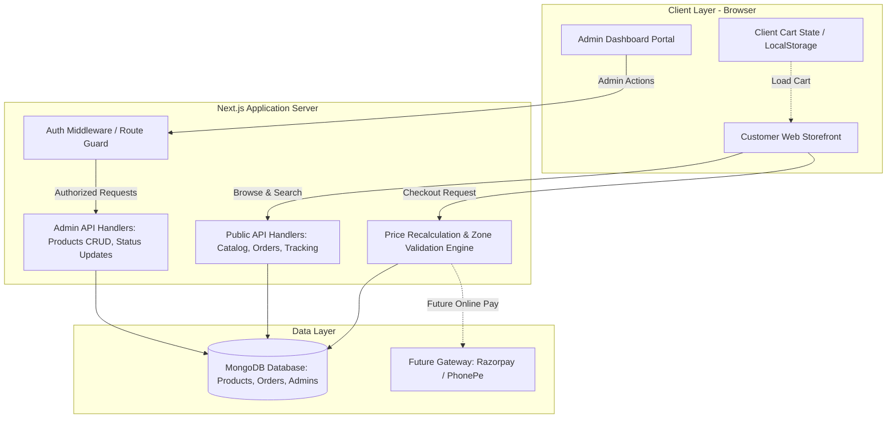
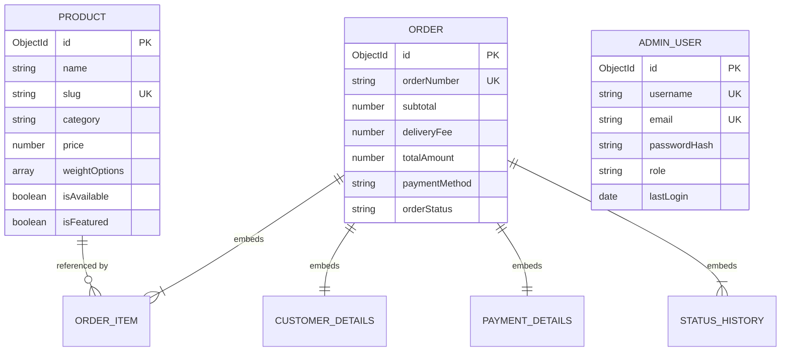
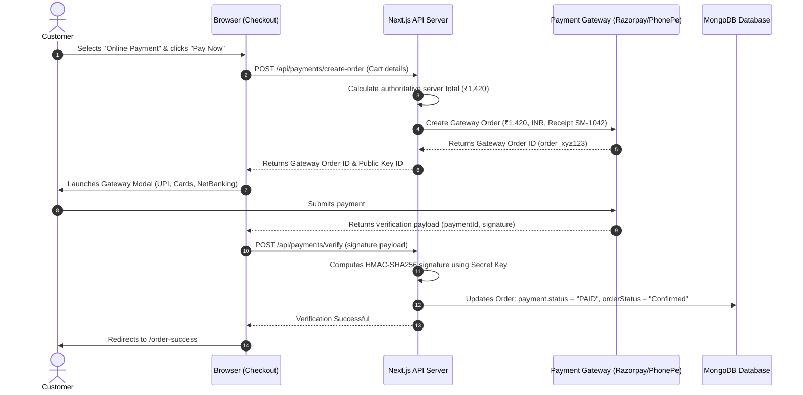

# Sangita Mithai — Master Project Plan

**Document Version:** 1.0.0  
**Current Phase:** Phase 1 (Planning & Architecture Only)  
**Status:** Complete Master Blueprint Awaiting Shop Owner Approval  
**Authors:** Software Architect, UI/UX Lead, Product Manager, and Database Engineer  
**Scope:** End-to-End Master Blueprint from Vision and Architecture to Testing, Deployment, and Launch  

---

## Executive Summary & Document Purpose

This **Master Project Plan** unites all architectural, product, design, database, security, and operational plans for the **Sangita Mithai (संगीता मिठाई)** e-commerce web platform into a single definitive reference document.

It synthesizes and aligns the 10 core planning deliverables:
- [PROJECT-PLAN.md](file:///c:/Users/DELL/OneDrive/Documents/sangita%20mithai/PROJECT-PLAN.md) — Strategic roadmap, personas, and business scope
- [PRD.md](file:///c:/Users/DELL/OneDrive/Documents/sangita%20mithai/PRD.md) — Product requirements (`FR-001+`, `NFR-001+`) and acceptance criteria
- [TECHNICAL-PLAN.md](file:///c:/Users/DELL/OneDrive/Documents/sangita%20mithai/TECHNICAL-PLAN.md) — System architecture, Next.js framework, and security
- [DESIGN-PLAN.md](file:///c:/Users/DELL/OneDrive/Documents/sangita%20mithai/DESIGN-PLAN.md) — Visual styling, card anatomy, and photography rules
- [TASKS.md](file:///c:/Users/DELL/OneDrive/Documents/sangita%20mithai/TASKS.md) — Phased task breakdown across Phases 1 through 6
- [README.md](file:///c:/Users/DELL/OneDrive/Documents/sangita%20mithai/README.md) — Project index and current status statement
- [TRD.md](file:///c:/Users/DELL/OneDrive/Documents/sangita%20mithai/TRD.md) — Technical requirements, API contracts, and Mongoose interfaces
- [APP-FLOW.md](file:///c:/Users/DELL/OneDrive/Documents/sangita%20mithai/APP-FLOW.md) — Customer and admin user journeys and edge cases
- [UI-UX-DESIGN-BRIEF.md](file:///c:/Users/DELL/OneDrive/Documents/sangita%20mithai/UI-UX-DESIGN-BRIEF.md) — 4px spacing grid, color tokens, and wireframes
- [BACKEND-SCHEMA.md](file:///c:/Users/DELL/OneDrive/Documents/sangita%20mithai/BACKEND-SCHEMA.md) — Database design, collections, and integrity rules

> ⚠️ **Project State Boundary Notice:** The project is currently strictly in **Phase 1 (Planning and Documentation)**. Early prototype drafts exist in the workspace, but full storefront implementation, live database connection, payment gateway activation, and customer order processing remain **NOT STARTED** until explicit review and approval by the shop owner.

---

## 1. Project Overview

### 1.1 Brand Identity & Mission
**Sangita Mithai (संगीता मिठाई)** is an artisan traditional Indian sweets emporium that bridges centuries-old confectionery craftsmanship (*khandani mithai karigari*) with the speed and convenience of modern digital ordering.

- **Emotional Resonance:** Warmth, Indian hospitality (*Atithi Devo Bhava*), and festive sweetness (*mithas*). Walking through the digital storefront evokes the rich aroma of pure desi cow ghee, roasted gram flour, cardamom, and saffron.
- **Culinary Purity:** 100% pure vegetarian confectionery made with authentic Bilona cow ghee, whole dry fruits, fresh milk solids (*khoya* and *chhena*), and zero chemical adulteration.
- **Convenience for Households:** Effortless ordering for daily cravings, evening tea, festive gifting (Diwali, Raksha Bandhan), wedding boxes, and religious offerings (*pooja prasad*).
- **Owner-Centric Management:** A clean, secure Admin Dashboard that enables the shop owner to update sweet rates, toggle sold-out items, and manage incoming delivery orders without technical assistance.

### 1.2 Target User Personas

| Persona | Role | Key Needs & Behaviors | Access Level |
| :--- | :--- | :--- | :--- |
| **Local Sweet Enthusiast (Customer)** | Buys sweets for household cravings or sudden guests. | Needs mobile-friendly browsing, clear portion sizes (250g, 500g, 1kg), fast checkout without mandatory registration, and quick local delivery. | Public Storefront only. |
| **Festival & Event Planner (Customer)** | Orders bulk sweets and gift boxes for weddings, poojas, or festivals. | Needs assorted gift hampers, transparent ingredient lists, storage advice, delivery instructions, and bulk coordination. | Public Storefront only. |
| **Shop Owner / Store Manager (Admin)** | Oversees kitchen stock, daily pricing, and delivery boy dispatch. | Needs a fast, authenticated dashboard on phone or computer to toggle in-stock/sold-out status, adjust rates, and advance order statuses. | Authenticated Admin Portal only. |

---

## 2. Scope & Core Requirements

### 2.1 Customer-Facing Scope
1. **Catalog of 13 Core Sweets:** Displayed with category filters, keywords search, dietary badges, and starting prices.
2. **Dynamic Portion Selection:** Instant switching between 250g, 500g, 1kg, per-piece, or gift box options with live price updates.
3. **Persistent Shopping Cart:** LocalStorage-backed cart that preserves items across page refreshes and browser crashes.
4. **Frictionless Guest Checkout:** Single-page checkout collecting customer name, 10-digit mobile number, street address, and PIN code without forced account creation.
5. **Cash on Delivery (COD):** Seamless doorstep cash payment at launch.
6. **Order Confirmation & Tracking:** Immediate unique Order Reference ID generation (`#SM-XXXX`) and privacy-protected status tracking requiring both Order ID and phone number.

### 2.2 Shop Owner Administrative Scope
1. **Protected Admin Route:** Next.js Edge Middleware route guard ensuring only authenticated sessions access `/admin/*`.
2. **Order Fulfillment Feed:** Live feed of orders sorted newest first with 1-click status advancement: `Pending` → `Confirmed` → `Preparing` → `Out for Delivery` → `Delivered`.
3. **Product & Pricing Management:** 1-click toggle for *In Stock / Sold Out* sweets, plus an edit modal to modify portion tier prices.
4. **Daily Metrics:** Real-time summary cards for Today's Orders, Pending Dispatches, Today's Revenue, and Active Sweets.

### 2.3 Explicit Out-of-Scope Exclusions (Current Release)
- **Multi-vendor Marketplace:** Platform serves single-store Sangita Mithai operations only.
- **National / International Courier Shipping:** Fresh milk sweets spoil rapidly; delivery is strictly local city delivery.
- **Native iOS/Android App Store App:** The platform is engineered as a responsive Progressive Web App (PWA)-friendly website.
- **Live GPS Driver Tracking:** Drivers coordinate via phone; status updates are milestone-based.

---

## 3. Complete Website Pages (10 Pages)

```
+---------------------------------------------------------------------------------------------------------+
|                                        GLOBAL HEADER NAVIGATION                                         |
|  [Logo: Sangita Mithai]    [Home]    [Shop Sweets]    [About Us]    [Contact Us]    [🔍]    [🛒 Cart]   |
+---------------------------------------------------------------------------------------------------------+
       |                           |                |              |                    |          |
       v                           v                v              v                    v          v
   +-------+                  +---------+      +----------+   +----------+          +-------+  +--------+
   | 1.Home|                  | 2.Shop  |      | 8.About  |   | 9.Contact|          |Search |  | 4.Cart |
   | Page  |                  | Catalog |      | Us Page  |   | Us Page  |          | Modal |  | Drawer |
   +-------+                  +---------+      +----------+   +----------+          +-------+  +--------+
       |                           |                                                               |
       v                           v                                                               v
   +-------+                  +---------+                                                     +----------+
   |Featured                  | 3.Prod  | --------------------------------------------------> | 5.Check- |
   |Sweets |                  | Details |                                                     | out Page |
   +-------+                  +---------+                                                     +----------+
                                                                                                   |
                                                                                                   v
                                                                                              +----------+
                                                                                              | 6.Order  |
                                                                                              | Success  |
                                                                                              +----------+
                                                                                                   |
                                                                                                   v
                                                                                              +----------+
                                                                                              | 7.Track  |
                                                                                              | Order    |
                                                                                              +----------+
```

| Page # | Route | Purpose & Key Features | Primary User Action |
| :---: | :--- | :--- | :--- |
| **1** | **Home Page (`/`)** | Hero banner with warm Indian motif, "Order Sweets Now" CTA, 4 purity trust badges, signature sweets grid, festive gift box banner, and customer testimonials. | Click **"Order Sweets Now"** to open Shop. |
| **2** | **Sweets / Shop Page (`/shop`)** | Full 13-product catalog, sticky category filter bar (`All`, `Milk`, `Bengali`, `Dry Fruit`, `Traditional`, `Gift Boxes`), debounced live search, and portion selector pills. | Tap portion pills and click **"Add to Box"**. |
| **3** | **Product Details (`/shop/[slug]`)** | High-resolution image gallery, culinary narrative, ingredients list, shelf-life advice, portion selector, quantity stepper `[-] [qty] [+]`, and "Add to Sweet Box" CTA. | Choose portion & quantity, click **"Add to Sweet Box"**. |
| **4** | **Cart Page (`/cart`) & Drawer** | Line items breakdown, portion badges, quantity controls, remove buttons, free delivery progress meter, and order financial totals. | Verify cart and click **"Proceed to Checkout"**. |
| **5** | **Checkout Page (`/checkout`)** | Two-column desktop / single-column mobile. Delivery form (Name, 10-digit Phone, Street, PIN), inline PIN zone check, COD radio selection, and sticky order review card. | Fill verified delivery address and click **"Confirm & Place Order"**. |
| **6** | **Order Success Page (`/order-success`)** | Festive golden card, green checkmark, unique Order Reference ID (`#SM-XXXX`), item summary, estimated preparation time, and track order CTA. | Copy Order Reference ID and click **"Track Your Order"**. |
| **7** | **Order Status Page (`/track-order`)** | Privacy authentication lookup (Order ID + Mobile Phone Number), 5-milestone progress stepper, masked address, and shop contact helpline. | Enter credentials to view preparation and delivery status. |
| **8** | **About Us Page (`/about`)** | History and heritage of Sangita Mithai, promise of 100% pure cow ghee, artisan craftsmanship (*karigars*), and kitchen photos. | Learn brand heritage and click **"Explore Our Sweets"**. |
| **9** | **Contact Us Page (`/contact`)** | Physical shop address placeholder (*TBD*), phone and WhatsApp links (*TBD*), opening hours (*TBD*), inquiry form, and Google Map embed placeholder. | Initiate WhatsApp conversation or submit bulk inquiry. |
| **10** | **Admin Portal (`/admin` & `/admin/login`)** | Secure login, KPI metric cards, reverse-chronological order feed with 1-click status advancement, and product stock/price editor. | Accept incoming orders, advance status, and manage inventory. |

---

## 4. Product Catalog & Pricing Plan (13 Core Sweets)

The launch menu features 13 staple Indian sweets divided into 5 authentic culinary categories:

| # | Sweet Name | Primary Category | Selling Method | Portion Tiers & Sample Prices | Flavor & Culinary Profile |
| :- | :--- | :--- | :--- | :--- | :--- |
| **1** | **Kaju Katli** | Dry Fruit Sweets | Weight | 250g (₹320), 500g (₹620), 1kg (₹1,200) | Goan cashew diamond fudge finished with pure vegetarian silver leaf (*chandi vark*). |
| **2** | **Gulab Jamun** | Milk Sweets | Weight / Pieces | 250g / 6 pcs (₹180), 500g / 12 pcs (₹340), 1kg / 24 pcs (₹650) | Mawa dumplings fried in desi ghee and steeped in cardamom-rose scented syrup. |
| **3** | **Rasgulla** | Bengali Sweets | Weight / Pieces | 500g / 8 pcs (₹170), 1kg / 16 pcs (₹320) | Airy, spongy cow milk chhena spheres soaked in light cardamom sugar syrup. |
| **4** | **Rasmalai** | Bengali Sweets | Pieces / Weight | 250g / 4 pcs (₹240), 500g / 8 pcs (₹460), 1kg / 16 pcs (₹880) | Chhena discs floating in slow-simmered saffron rabdi with crushed pistachios. |
| **5** | **Motichoor Ladoo** | Traditional Mithai | Weight | 250g (₹190), 500g (₹360), 1kg (₹680) | Micro-fine chickpea pearls fried in pure cow ghee with saffron and melon seeds. |
| **6** | **Besan Ladoo** | Traditional Mithai | Weight | 250g (₹180), 500g (₹340), 1kg (₹650) | Slow-roasted coarse gram flour laddoos with crunchy cashews and boora sugar. |
| **7** | **Milk Cake** | Milk Sweets | Weight | 250g (₹210), 500g (₹400), 1kg (₹780) | Caramelized grainy dual-tone Rajasthani Kalakand fudge with roasted center. |
| **8** | **Peda** | Milk Sweets | Weight | 250g (₹190), 500g (₹360), 1kg (₹700) | Mathura-style caramelized khoya rounds infused with green cardamom and nutmeg. |
| **9** | **Barfi** | Milk Sweets | Weight | 250g (₹190), 500g (₹360), 1kg (₹700) | Velvety white mawa fudge topped with crushed Iranian pistachios. |
| **10** | **Soan Papdi** | Traditional Mithai | Weight / Box | 250g (₹160), 500g (₹300), 1kg (₹580) | Crisp, flaky, melt-in-mouth multi-layered sweet strands made with roasted flour. |
| **11** | **Jalebi** | Traditional Mithai | Weight | 250g (₹140), 500g (₹270), 1kg (₹520) | Crisp fermented batter pretzels fried in ghee and dipped in warm saffron nectar. |
| **12** | **Dry Fruit Mithai** | Dry Fruit Sweets | Weight / Box | 250g (₹340), 500g (₹660), 1kg (₹1,280) | Anjeer (fig) barfi, kaju pista rolls, and dates & almond bites with no added sugar. |
| **13** | **Mithai Gift Boxes** | Gift Boxes | Box / Hamper | 500g Luxury Box (₹650), 1kg Royal Hamper (₹1,250) | Satin-finish keepsake hampers curated with signature sweets for gifting. |

> 💡 **Owner Customization:** All price figures listed above represent standard planning estimates. Final retail prices and tier configurations will be reviewed and confirmed by the shop owner (*TBD*).

---

## 5. UI/UX & Design System Foundation

### 5.1 Color Tokens & WCAG Contrast Matrix

```
[ Royal Vermilion ]   [ Saffron Gold ]   [ Warm Cream ]   [ Cardamom Amber ]   [ Pure Veg Green ]
     #991B1B               #D97706           #FFFDF7           #F59E0B             #15803D
```

- **Primary Brand Color (`--color-primary`: `#991B1B`):** Royal Vermilion representing celebration, auspicious beginnings, and passion. Used for primary action buttons, active navigation markers, and hero accents. Contrast against white: **6.4:1** (WCAG AA).
- **Secondary Brand Color (`--color-secondary`: `#D97706`):** Festive Saffron Orange representing Kashmiri kesar and temple warmth. Used for secondary CTAs and promo chips. Contrast against dark text `#1E1E24`: **5.1:1** (WCAG AA).
- **Page Background (`--color-bg-page`: `#FFFDF7`):** Warm Ghee Cream reminiscent of milk solids (*rabdi*); gentle on eyes, replaces harsh digital white. Contrast against charcoal text: **14.8:1** (WCAG AAA).
- **Card Surface (`--color-surface-card`: `#FFFFFF`):** Pure Chhena White for product cards, dialog modals, and form inputs.
- **Subtle Surface (`--color-bg-subtle`: `#FEF9C3`):** Rabdi Light Yellow for notification strips and highlights.
- **Main Text (`--color-text-main`: `#1E1E24`):** Charcoal Espresso for high-legibility headings and body copy.
- **Muted Text (`--color-text-secondary`: `#64748B`):** Cardamom Ash for secondary notes and ingredients.
- **Semantic States:**
  - *Success (`#15803D`):* 100% vegetarian mark, valid PIN checkmarks, and successful orders.
  - *Warning (`#B45309`):* Low stock alerts and perishable shelf-life notices.
  - *Information (`#0369A1`):* Order notes and preparation time guidance.
  - *Error (`#DC2626`):* Form errors, sold-out tags, and delivery zone alerts.

### 5.2 Typography System (Bilingual English & Devanagari)
- **Headings & Royal Titles:** English `'Cinzel'` / Hindi `'Rozha One'`. Regal, classical, and celebratory.
- **Body & UI Elements:** English `'Outfit'` / Hindi `'Noto Sans Devanagari'`. Clean, modern, highly legible at small sizes on mobile screens.
- **Numeric Figures:** `font-variant-numeric: tabular-nums` applied across all price displays and tables to prevent layout wobbling.
- **Mobile Input Rule:** Strictly minimum **16px** font size on form inputs to prevent iOS Safari auto-zoom on touch focus.

### 5.3 4px Spacing Grid & Elevation Scale
- **Spacing Tokens:** `--space-1` (4px), `--space-2` (8px), `--space-3` (12px), `--space-4` (16px), `--space-5` (20px), `--space-6` (24px), `--space-8` (32px), `--space-10` (40px), `--space-12` (48px), `--space-16` (64px), `--space-20` (80px).
- **Container Boundaries:** Max container width `1280px` (`--container-max`); narrow container `768px` (`--container-narrow`) for checkout and tracking.
- **Responsive Screen Gutters:** 16px (Mobile), 24px (Tablet), 32px (Desktop).
- **Product Card Grids:** 1 column (Mobile 360–479px), 2 columns (Phablets & Tablets 480–1023px), 3–4 columns (Desktop 1024px+).
- **Elevation Shadows:** Subtle warm vermilion undertone (`rgba(153, 27, 27, 0.08)`) providing ambient warmth instead of cold gray.
- **Touch Target Rule:** Minimum **44px × 44px** hit target for all interactive buttons, tabs, pills, and steppers.

---

## 6. End-to-End Customer Journey

```
+-----------+     +------------+     +-----------------+     +-----------+
| Home Page | --> | Shop / All | --> | Product Details | --> | Cart Page |
+-----------+     +------------+     +-----------------+     +-----------+
      |                 |                                          |
      v                 v                                          v
+-----------+     +------------+                            +---------------+
| About /   |     | Category   |                            | Checkout Page |
| Contact   |     | Filter     |                            +---------------+
+-----------+     +------------+                                   |
                                                                   v
                                                        +---------------------+
                                                        | Order Success Page  |
                                                        +---------------------+
                                                                   |
                                                                   v
                                                        +---------------------+
                                                        | Order Tracking Page |
                                                        +---------------------+
```

1. **Discovery:** Customer visits `sangitamithai.com`, views hero sweet platter, and clicks **"Order Sweets Now"**.
2. **Browsing & Search:** Navigates to `/shop`, selects `"Dry Fruit Sweets"`, or types *"kaju"* in search bar (debounced client-side filter in < 100ms).
3. **Portion Selection:** Taps `[ 500g ]` pill on the Kaju Katli card; price tag updates dynamically to ₹620; clicks **"Add to Box"**.
4. **Cart Review:** Floating cart pill increments to `1 item - ₹620`; customer opens cart drawer; adjusts quantity to `2`; subtotal recalculates to ₹1,240; clicks **"Proceed to Checkout"**.
5. **Checkout Completion:** Customer enters Name, 10-digit Phone, Street Address, and PIN code. System verifies PIN against local delivery zone. Customer selects **Cash on Delivery (COD)**.
6. **Order Placement:** Clicks **"Confirm & Place Order"**. Button shows spinner and disables to prevent duplicate submissions. Server validates true prices from MongoDB and creates order record.
7. **Confirmation:** Browser clears `localStorage` cart; customer lands on `/order-success` displaying Order Reference ID `#SM-1042`.
8. **Tracking:** Customer enters `#SM-1042` + their phone number on `/track-order` to monitor the 5-milestone fulfillment journey.

---

## 7. Technical Architecture

### 7.1 Proposed Tech Stack

| Layer | Chosen Technology | Rationale & Compatibility |
| :--- | :--- | :--- |
| **Application Framework** | **Next.js 16 (App Router)** | Full-stack React framework supporting Server Components, Server Route Handlers, and automatic image optimization. |
| **UI Library** | **React 19** | Component-driven UI for reactive portion selectors, cart badges, and modal dialogs. |
| **Language** | **TypeScript 5** | Strict compile-time typing for product units, order payloads, and API contracts. |
| **Styling Architecture** | **Vanilla CSS & CSS Modules** | Fast, zero-dependency styling using CSS variables without Tailwind utility bloat. |
| **Iconography** | **Lucide React** | Lightweight icons for shopping carts, search, vegetarian emblems, and delivery trucks. |
| **Database** | **MongoDB** | Flexible document database ideal for variable product portion tiers and nested order documents. |
| **Object Data Modeling** | **Mongoose 9** | Enforces schemas, validation constraints, and indexes on MongoDB collections. |
| **Session Security** | **JWT & Bcrypt** | Salted password hashing (12 rounds) and signed HTTP-only secure session cookies. |

### 7.2 High-Level System Architecture Diagram



### 7.3 Serverless MongoDB Connection Strategy
To prevent connection leaks and exhaustion in Next.js serverless route handlers, the MongoDB connection is cached across requests via a global singleton (`src/lib/mongodb.ts` pattern):
```typescript
// Connection caching pattern planned for Phase 4
let cached = global.mongooseCache || { conn: null, promise: null };
if (!global.mongooseCache) global.mongooseCache = cached;
```

---

## 8. Backend & Database Schema

### 8.1 Collections Overview



### 8.2 Products Collection (`products`)
- **Fields:** `name` (string, required), `slug` (string, unique), `category` (enum: `['milk-sweets', 'bengali-sweets', 'dry-fruit-sweets', 'traditional-mithai', 'gift-boxes']`), `description` (string), `shortDescription` (string), `price` (number, min 0), `compareAtPrice` (optional MRP), `images` (array of relative paths), `ingredients` (array), `weightOptions` (array of `{ label: string, price: number }`), `isAvailable` (boolean, default true), `isFeatured` (boolean), `isBestSeller` (boolean), `stock` (number, min 0), `tags` (array of search tags), `rating` (number), `reviewCount` (number).
- **Indexes:** Compound text index on `{ name, description, shortDescription, tags }`; unique index on `{ slug: 1 }`; filtering indexes on `{ category: 1, isAvailable: 1 }` and `{ isFeatured: 1 }`.

### 8.3 Admins Collection (`admins`)
- **Fields:** `username` (string, unique, lowercase), `email` (string, unique), `passwordHash` (string, bcrypt salted hash), `role` (enum: `['OWNER']`), `lastLogin` (date).
- **Security:** Pre-save bcrypt hashing hook (12 rounds) and `toJSON` transform that strips `passwordHash` from query outputs.

### 8.4 Orders Collection (`orders`)
- **Master Fields:** `orderNumber` (string, unique, e.g., `"SM-1042"`), `subtotal` (number), `deliveryFee` (number), `totalAmount` (number), `orderStatus` (enum: `['Pending', 'Confirmed', 'Preparing', 'Out for Delivery', 'Delivered', 'Cancelled']`), `cancellationReason` (optional string), `statusHistory` (array of audit timestamps), timestamps (`createdAt`, `updatedAt`).
- **Embedded `customer` Details:** `name` (string), `phone` (10-digit Indian mobile regex `/^[6-9]\d{9}$/`), `address` (string), `landmark` (optional), `city` (string), `pincode` (6-digit regex `/^\d{6}$/`), `deliveryNotes` (optional).
- **Embedded `items` Array (Price Snapshot Pattern):** `productId` (ObjectId ref `'Product'`), `name` (snapshot of sweet title), `selectedOption` (snapshot of portion label e.g., `"500g"`), `unitPrice` (frozen price at purchase), `quantity` (integer, min 1, max 20), `lineTotal` (`unitPrice * quantity`).
- **Embedded `payment` Details:** `method` (`'COD' | 'ONLINE'`), `status` (`'PENDING' | 'PAID' | 'FAILED'`), `gateway` (optional string), `gatewayOrderId`, `gatewayPaymentId`, `gatewaySignature`, `paidAt`.
- **Indexes:** Unique on `{ orderNumber: 1 }`; compound on `{ orderNumber: 1, "customer.phone": 1 }` for tracking lookup; index on `{ orderStatus: 1, createdAt: -1 }` for admin listing.

---

## 9. Authentication & Security Architecture

### 9.1 Admin Authentication Mechanism
1. **Credentials:** Shop owner logs in at `/admin/login` using username/email and password.
2. **Server Verification:** Server retrieves admin document from MongoDB and verifies password with `bcrypt.compare(inputPassword, admin.passwordHash)`.
3. **Session Issuance:** Server creates a signed JWT session token stored in a secure cookie (`sm_admin_session`) with strict attributes:
   - `HttpOnly: true` (inaccessible to browser JavaScript; immunizes against XSS token theft).
   - `Secure: true` (transmitted strictly over HTTPS in production).
   - `SameSite: 'Strict'` (immunizes against Cross-Site Request Forgery - CSRF).
   - `Path: '/'`.
4. **Middleware Protection:** Next.js Edge Middleware intercepts all requests to `/admin/*` and `/api/admin/*`. Unauthenticated requests redirect to `/admin/login` or receive `401 Unauthorized`.

### 9.2 Protection of Customer Order Data & Privacy
- **No Predictable Public URLs:** Orders are not accessible by sequential numeric IDs.
- **Dual-Factor Lookup:** Order tracking (`/api/orders/track`) strictly requires both `orderNumber` (e.g., `SM-1042`) **and** the matching 10-digit `phone` number.
- **Timing & Enumeration Resistance:** If credentials do not match, the server returns a generic `404 Order Not Found` without disclosing whether the order number exists.
- **Address Masking:** Public order tracking responses display masked addresses (e.g., *"Flat 302, Kr**** He****, Local City, PIN: 110001"*).

### 9.3 Zero Payment Card Storage (PCI-DSS Compliance)
The Sangita Mithai website and database **never** accept, handle, process, or store:
- 16-digit credit/debit card numbers (PAN).
- Card expiry dates.
- 3-digit or 4-digit CVV/CVC codes.
- Net banking credentials or UPI PINs.
All digital payment processing is delegated to licensed Indian payment gateway modals (Razorpay / PhonePe).

---

## 10. Order Management & Business Rules

To protect against pricing tampering, inventory errors, and order discrepancies, the platform enforces **5 Golden Business Rules**:

### Rule 1: Authoritative Server-Side Price Calculation
The browser is **never** trusted for pricing calculations. When an order is placed:
1. Server queries MongoDB for each sweet using `productId`.
2. Locates matching `selectedOption` (e.g., `"500g"`) in `product.weightOptions`.
3. Reads authoritative `option.price` from database.
4. Computes `lineTotal = option.price * quantity`.
5. Sums line totals for `subtotal`.
6. Adds `deliveryFee` according to shop zone rules.
7. Sets `totalAmount = subtotal + deliveryFee`. Any client-submitted total is discarded.

### Rule 2: Historic Price Freezing (Snapshot Pattern)
When an order is created, the sweet name, portion label, and unit price are saved directly into `Order.items`. Subsequent changes to sweet prices in the catalog never distort historical orders or accounting records.

### Rule 3: Stock Availability & In-Stock Guard
Before creating an order, the server verifies `product.isAvailable === true`. If an item is sold out, order placement is blocked with a descriptive message prompting cart correction.

### Rule 4: Quantity Boundaries
Each line item enforces a minimum quantity of **1** and a maximum quantity of **20** units, preventing negative calculations or accidental bulk kitchen overloads.

### Rule 5: Delivery Zone PIN Code Guard
Order creation verifies the entered PIN code against the shop's approved delivery zone list (`SHOP_ALLOWED_PINCODES` in `.env.local`).

---

## 11. Delivery Rules & Operational Boundaries

| Delivery Parameter | Planning Specification | Status |
| :--- | :--- | :--- |
| **Operating Delivery City** | Single local metropolitan area surrounding the physical sweet shop. | **TBD by owner** |
| **Eligible Delivery PIN Codes** | Comma-separated list in `SHOP_ALLOWED_PINCODES` environment variable. | **TBD by owner** |
| **Standard Delivery Fee** | Applied if order subtotal is below the free delivery threshold (Placeholder: `₹40`). | **TBD by owner** |
| **Free Delivery Threshold** | Order subtotal that qualifies for free delivery (Placeholder: Free for orders ≥ `₹500`). | **TBD by owner** |
| **Minimum Order Amount** | Minimum basket value required to checkout (Placeholder: `₹150`). | **TBD by owner** |
| **Operating Hours & Same-Day Cutoff** | Kitchen packing hours and daily order cutoff (Placeholder: 9:00 AM – 9:30 PM). | **TBD by owner** |

---

## 12. Payment Plan: COD & Future Online Gateway

### 12.1 Phase 1–4 Launch: Cash on Delivery (COD) Focus
- Cash on Delivery is traditional, trusted, and frictionless for local Indian sweets:
  1. Customer selects COD at checkout.
  2. Order is saved with `payment.method = "COD"`, `payment.status = "PENDING"`, and `orderStatus = "Pending"`.
  3. Rider delivers the fresh sweet box and collects cash at the doorstep.
  4. Shop owner marks order as `Delivered` and updates payment status to `PAID` in the Admin Dashboard.

### 12.2 Phase 5: Future Online Payment Gateway Architecture



#### Verification Safeguards for Online Payments:
1. **Cryptographic Signature Verification:** An order is marked `PAID` **only** after the backend verifies the cryptographic `HMAC-SHA256` signature using the private gateway secret key in `.env.local`.
2. **Server-to-Server Webhook:** An idempotent webhook handler (`POST /api/payments/webhook`) ensures payments are captured even if the customer closes their browser before redirection.
3. **Double-Payment Protection:** Gateway order IDs are mapped 1-to-1 with internal orders to prevent duplicate debit charges.

---

## 13. Phased Development Roadmap

The project is structured into **6 clear implementation phases**:

```
[ Phase 1: Planning & Architecture ]  <-- (WE ARE HERE: Complete & Awaiting Owner Approval)
                  ↓
[ Phase 2: UI/UX Design System Foundation ]
                  ↓
[ Phase 3: Main Storefront Pages & Cart ]
                  ↓
[ Phase 4: Database Models & Admin Portal ]
                  ↓
[ Phase 5: Real Order Processing & Payments ]
                  ↓
[ Phase 6: Testing, Polish & Launch ]
```

- **Phase 1: Planning & Architecture (Current Phase — 100% Complete)**  
  Document all specifications, schemas, flows, design tokens, and business logic.
- **Phase 2: UI/UX Design System Foundation**  
  Establish `globals.css` with 4px grid and color tokens, load Google Fonts, create reusable Atomic UI components (Buttons, Inputs, Badges, Modals), and responsive Header/Footer shells.
- **Phase 3: Main Website Storefront Pages**  
  Implement Home Page, Sweets Catalog with live search and category filtering, Product Details page, Cart context with `localStorage` persistence, Checkout form with client validation, and informational pages.
- **Phase 4: Database Models & Admin Management**  
  Establish cached MongoDB connection helper, define Mongoose schemas (`Product`, `Order`, `AdminUser`), seed 13 core sweets, implement secure admin authentication (bcrypt + JWT cookies), and build the Admin Dashboard.
- **Phase 5: Real Order Processing & Payments**  
  Implement server-side price validation API, PIN code delivery zone checker, end-to-end Cash on Delivery order flow, secure two-factor order tracking, and sandbox online payment architecture.
- **Phase 6: Testing, Polish & Launch Preparation**  
  Execute cross-device responsive audits, run security checks, verify cart calculation edge cases, substitute shop owner placeholders with confirmed data, and deploy to production.

---

## 14. Comprehensive Testing Plan

### 14.1 UI & Cross-Device Responsive Testing
- **Viewport Testing:**
  - Mobile Compact: iPhone SE, Android 360px viewport (single column, sticky bottom navigation).
  - Mobile Standard: iPhone 14/15, Galaxy S23 390–430px viewport.
  - Tablet: iPad 768px and iPad Pro 1024px viewport (2-column grid, top navigation).
  - Desktop: Laptop 1366px and 1440px+ widescreen displays (3–4 column catalog, 2-column checkout).
- **Accessibility (A11y) Audits:**
  - Verify WCAG AA color contrast (minimum 4.5:1 for body copy).
  - Test keyboard navigation across portion pills, modals, and checkout inputs (`Tab`, `Enter`, `Escape`).
  - Screen reader audit: ensure descriptive sweet image alt tags and `aria-live="polite"` dynamic price announcements.

### 14.2 Form Validation & Cart Calculation Testing
- **Input Validation:**
  - Phone validation: test invalid phone lengths (< 10 or > 10 digits), non-Indian prefixes (e.g., starting with 1–5), and letters.
  - PIN code validation: test non-digit characters, 5-digit PINs, and out-of-zone PIN codes.
- **Cart Edge Cases:**
  - Rapid portion switching: verify displayed price updates instantly without race conditions.
  - Quantity bounds: verify inability to decrement below 1 or increment above 20 units.
  - Cart persistence: verify cart items remain intact after page refresh or browser close.
  - Sold-out handling: verify cart alerts customer if an item is toggled out of stock by admin.

### 14.3 Order & Admin Workflow Audits
- **End-to-End COD Order Creation:** Place order from guest cart → verify MongoDB record created → verify cart reset in browser → verify Order Reference ID display.
- **Admin Status Lifecycle:** Advance order from `Pending` → `Confirmed` → `Preparing` → `Out for Delivery` → `Delivered`. Verify order status updates reflect on customer tracking page.
- **Security & Privacy Wall:**
  - Attempt accessing `/admin` without authentication; verify redirect to `/admin/login`.
  - Attempt querying `/api/orders/track` with incorrect phone number; verify access is rejected with `404 Not Found`.
  - Verify client JavaScript bundles contain zero database URIs or JWT secrets.

### 14.4 Payment Sandbox Testing (Phase 5)
- Test successful payment flow with gateway test credentials.
- Test cancelled/dismissed modal flow; verify user returns to checkout with intact cart.
- Test signature tampering; verify server rejects invalid signatures and logs security alert.

---

## 15. Deployment & Production Setup

### 15.1 Hosting & Infrastructure Architecture
- **Web Application Host:** Vercel or AWS / DigitalOcean Node.js 18+ server supporting Next.js 16 App Router.
- **Managed Database:** MongoDB Atlas (M0 tier for staging/development, M10+ tier for high-availability production with automated daily backups).
- **Domain & SSL:** Custom domain (`sangitamithai.com` / `sangitamithai.in`) with automated Let's Encrypt SSL certificate enforcing HTTPS.
- **Asset CDN:** Next.js automatic image optimization serving optimized WebP images directly from Edge CDN.

### 15.2 Environment Variables Plan (`.env.local`)

```bash
# ==========================================
# Sangita Mithai — Environment Configuration
# ==========================================

# Database Connection (MongoDB Atlas)
MONGODB_URI="mongodb+srv://<username>:<password>@cluster0.mongodb.net/sangita_mithai?retryWrites=true&w=majority"

# Security & Authentication Secrets
JWT_SECRET="generate-a-secure-random-64-character-secret-key-here"
ADMIN_SESSION_COOKIE="sm_admin_session"

# Shop Delivery Operational Settings
SHOP_DELIVERY_CITY="Local City Placeholder"
SHOP_ALLOWED_PINCODES="110001,110002,110003" # Comma-separated allowed delivery PIN codes
SHOP_DELIVERY_FEE=40
SHOP_FREE_DELIVERY_THRESHOLD=500
SHOP_MIN_ORDER_AMOUNT=150

# Future Payment Gateway Integration (Phase 5)
PAYMENT_GATEWAY_PROVIDER="RAZORPAY" # Options: RAZORPAY, CASHFREE, PHONEPE
PAYMENT_GATEWAY_KEY_ID=""
PAYMENT_GATEWAY_KEY_SECRET=""
PAYMENT_GATEWAY_WEBHOOK_SECRET=""
```

---

## 16. Phased Implementation Tasks Checklist

```
+---------------------------------------------------------------------------------------------------------------+
| PHASE 1: Planning & Architecture [COMPLETED]                                                                   |
| [X] TASK-P1-01: Workspace & dependency inspection                                                              |
| [X] TASK-P1-02: Strategic Project Plan (PROJECT-PLAN.md)                                                       |
| [X] TASK-P1-03: Product Requirements Document (PRD.md)                                                         |
| [X] TASK-P1-04: Technical Architecture Plan (TECHNICAL-PLAN.md)                                                |
| [X] TASK-P1-05: Visual Design Plan (DESIGN-PLAN.md)                                                            |
| [X] TASK-P1-06: Phased Tasks Matrix (TASKS.md)                                                                 |
| [X] TASK-P1-07: Project Readme & Status Index (README.md)                                                      |
| [X] TASK-P1-08: Application Flow & Decision Trees (APP-FLOW.md)                                                |
| [X] TASK-P1-09: UI/UX Design Brief (UI-UX-DESIGN-BRIEF.md)                                                     |
| [X] TASK-P1-10: Backend Database Schema (BACKEND-SCHEMA.md)                                                    |
| [X] TASK-P1-11: Complete Master Project Plan (MASTER-PROJECT-PLAN.md)                                          |
+---------------------------------------------------------------------------------------------------------------+
| PHASE 2: UI/UX Design System Foundation [NOT STARTED - Awaiting Owner Approval]                                |
| [ ] TASK-P2-01: Define Global CSS variables & 4px spacing scale in globals.css                                 |
| [ ] TASK-P2-02: Configure Google Fonts (Cinzel / Rozha One, Outfit / Noto Sans)                                |
| [ ] TASK-P2-03: Build responsive Header and Mobile Bottom Navigation bar                                       |
| [ ] TASK-P2-04: Build reusable Footer with traditional brand styling and contact placeholders                 |
| [ ] TASK-P2-05: Build atomic UI components (Buttons, Inputs, Badges, Modals)                                   |
+---------------------------------------------------------------------------------------------------------------+
| PHASE 3: Main Storefront Pages & Cart [NOT STARTED - Awaiting Phase 2]                                         |
| [ ] TASK-P3-01: Implement Home Page (/) with hero banner and featured sweets                                   |
| [ ] TASK-P3-02: Implement Sweets / Shop Page (/shop) with 5 category filter tabs                              |
| [ ] TASK-P3-03: Implement debounced real-time sweet Search bar                                                 |
| [ ] TASK-P3-04: Implement interactive Product Card with multi-portion selector pills                           |
| [ ] TASK-P3-05: Implement Product Details Page (/shop/[slug]) with narrative & ingredients                     |
| [ ] TASK-P3-06: Implement Cart State Context & Cart Page/Drawer (/cart) with LocalStorage                      |
| [ ] TASK-P3-07: Implement Checkout Page (/checkout) with delivery form & PIN validation                        |
| [ ] TASK-P3-08: Implement Order Success Page (/order-success) with reference ID                                |
| [ ] TASK-P3-09: Implement About Us (/about) and Contact Us (/contact) pages                                    |
+---------------------------------------------------------------------------------------------------------------+
| PHASE 4: Database Models & Admin Portal [NOT STARTED - Awaiting Phase 3]                                       |
| [ ] TASK-P4-01: Implement serverless-resilient MongoDB connection helper (src/lib/mongodb.ts)                  |
| [ ] TASK-P4-02: Finalize Mongoose schemas for Product, Order, and AdminUser                                    |
| [ ] TASK-P4-03: Update database seed script (scripts/seed.mjs) for all 13 core sweets                          |
| [ ] TASK-P4-04: Implement Admin Authentication (bcrypt + HTTP-only JWT cookies)                                 |
| [ ] TASK-P4-05: Build Admin Dashboard (/admin) order fulfillment feed and KPI metrics                          |
| [ ] TASK-P4-06: Build Admin Sweet Manager (stock availability toggle & price editing)                          |
+---------------------------------------------------------------------------------------------------------------+
| PHASE 5: Real Order Processing & Payments [NOT STARTED - Awaiting Phase 4]                                     |
| [ ] TASK-P5-01: Implement Server-Side Price Verification API (/api/orders)                                     |
| [ ] TASK-P5-02: Implement Delivery Zone PIN Code Validator                                                     |
| [ ] TASK-P5-03: Implement Cash on Delivery (COD) end-to-end flow with Order IDs                                |
| [ ] TASK-P5-04: Implement Customer Order Tracking (/track-order) with phone verification                       |
| [ ] TASK-P5-05: Prepare Online Payment Gateway architecture (Razorpay/PhonePe sandbox)                         |
+---------------------------------------------------------------------------------------------------------------+
| PHASE 6: Testing, Polish & Launch [NOT STARTED - Awaiting Phase 5]                                             |
| [ ] TASK-P6-01: Conduct cross-device responsive audits (iPhone SE to 4K displays)                              |
| [ ] TASK-P6-02: Conduct end-to-end checkout, cancellation, and order lifecycle audits                          |
| [ ] TASK-P6-03: Audit security, privacy walls, and environment secrets                                         |
| [ ] TASK-P6-04: Replace placeholder text with confirmed shop owner details                                    |
| [ ] TASK-P6-05: Production build compilation, database backup verification, and deployment                    |
+---------------------------------------------------------------------------------------------------------------+
```

---

## 17. Pending Decisions & Discrepancies Reconciliation Log

### 17.1 Unresolved Decisions Requiring Shop Owner Confirmation

| Open Parameter | UI / System Impact | Current Design Treatment | Responsible Party |
| :--- | :--- | :--- | :--- |
| **Official Shop Logo Asset** | Header and footer branding. | High-resolution typographic mark (*Sangita Mithai / संगीता मिठाई*) used initially. | **Shop Owner** |
| **Physical Shop Address & Phone** | Footer, Contact page, order receipts. | Generic placeholders displayed (*"Shop Address Placeholder, City, PIN"*). | **Shop Owner** |
| **Shop Opening Hours & Cutoff Time** | Top announcement bar, Contact page, delivery scheduling. | Standard placeholder (*9:00 AM – 9:30 PM Daily*) used. | **Shop Owner** |
| **Eligible Delivery PIN Codes** | PIN validation on checkout and order creation. | Managed via `SHOP_ALLOWED_PINCODES` environment variable. | **Shop Owner** |
| **Delivery Charges & Free Threshold** | Financial calculation on Cart and Checkout. | Default placeholder: ₹40 standard fee, Free for orders above ₹500. | **Shop Owner** |
| **Minimum Order Amount** | Minimum cart value required to checkout. | Configured via `SHOP_MIN_ORDER_AMOUNT` (e.g., ₹150 placeholder). | **Shop Owner** |
| **Real Shop Sweet Photographs** | Product cards and detail showcases. | Replaceable high-resolution sample photography used initially. | **Shop Owner** |
| **Online Payment Gateway Provider** | Checkout payment options (Phase 5). | COD enabled by default at launch; online gateways (Razorpay/PhonePe) marked Coming Soon. | **Shop Owner** |

### 17.2 Document Discrepancies & Alignment Record
During the consolidation of planning files and inspection of early draft code, two minor discrepancies were identified and resolved as follows:

1. **Category Taxonomy in Seed Script vs. Planning Documents:**
   - *Discrepancy:* `scripts/seed.mjs` contained an extra `'Namkeen'` category with 2 items and only 9 seeded sweets.
   - *Resolution:* All formal planning documents ([PROJECT-PLAN.md](file:///c:/Users/DELL/OneDrive/Documents/sangita%20mithai/PROJECT-PLAN.md), [PRD.md](file:///c:/Users/DELL/OneDrive/Documents/sangita%20mithai/PRD.md), [TRD.md](file:///c:/Users/DELL/OneDrive/Documents/sangita%20mithai/TRD.md), [UI-UX-DESIGN-BRIEF.md](file:///c:/Users/DELL/OneDrive/Documents/sangita%20mithai/UI-UX-DESIGN-BRIEF.md), and [BACKEND-SCHEMA.md](file:///c:/Users/DELL/OneDrive/Documents/sangita%20mithai/BACKEND-SCHEMA.md)) establish **5 core sweet categories** (*Milk Sweets, Bengali Sweets, Dry Fruit Sweets, Traditional Mithai, Gift Boxes*) and **13 core sweets**. In Phase 4, `scripts/seed.mjs` will be updated to seed all 13 core sweets strictly under these 5 categories.
2. **Order Model Structure in Draft Code vs. Schema Architecture:**
   - *Discrepancy:* Early draft file `src/lib/models/Order.ts` used separate `customer` and `shippingAddress` objects with customer email and string payment enums.
   - *Resolution:* The formal architecture defined in [BACKEND-SCHEMA.md](file:///c:/Users/DELL/OneDrive/Documents/sangita%20mithai/BACKEND-SCHEMA.md) and [TRD.md](file:///c:/Users/DELL/OneDrive/Documents/sangita%20mithai/TRD.md) standardizes on a unified embedded `customer` object (name, 10-digit phone, address, landmark, city, pincode, deliveryNotes), standardized enum `paymentMethod: 'COD' | 'ONLINE'`, and audit `statusHistory`. `src/lib/models/Order.ts` will be aligned to this standard when Phase 4 implementation commences.

---

## 18. Final Pre-Launch Verification Checklist

Before the website is declared live and opened to paying customers, the following conditions must be satisfied and verified:

### 18.1 Business & Content Readiness
- [ ] Shop owner has reviewed and approved final prices for all 13 sweets.
- [ ] Real shop address, customer support phone number, and WhatsApp link are populated.
- [ ] Shop operating hours and same-day delivery cutoff times are finalized.
- [ ] Eligible delivery PIN codes are verified and populated in production environment variables.
- [ ] Confirmed delivery charge and free delivery threshold are configured.

### 18.2 Technical & Security Readiness
- [ ] MongoDB Atlas production cluster provisioned with IP access controls and automated daily backups.
- [ ] Strong random 64-character `JWT_SECRET` generated and loaded into production secrets manager.
- [ ] Admin password hash securely seeded; default or weak passwords eliminated.
- [ ] All API routes verified: zero exposure of database credentials or admin secrets in client bundles.
- [ ] Dual-factor verification on `/track-order` verified: customer addresses masked and inaccessible to strangers.
- [ ] Server-side price calculation verified: client price manipulation attempts are rejected.

### 18.3 UI, Responsive & Operational Readiness
- [ ] Cross-device responsive layout verified on mobile (360px+), tablet, and desktop viewports.
- [ ] Form input validation verified on touch devices: 16px font prevents iOS zoom; invalid phone/PIN codes blocked with clear feedback.
- [ ] Cash on Delivery checkout flow tested end-to-end: order created, unique ID generated, and cart reset.
- [ ] Admin Dashboard tested: incoming orders appear instantly, and status updates advance cleanly.
- [ ] Custom domain (`sangitamithai.com`) linked with valid HTTPS SSL certificate.
- [ ] Production build (`npm run build`) compiles with zero TypeScript errors or ESLint violations.
