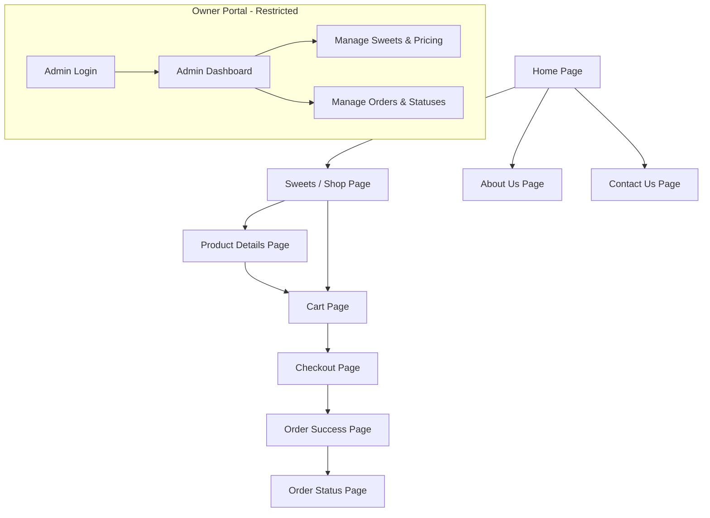

# Sangita Mithai — Project Plan

**Document Version:** 1.0.0  
**Status:** Approved for Review (Phase 1: Planning Only)  
**Target Audience:** Shop Owner, Development Team, UI/UX Designers  

---

## 1. Project Overview

### 1.1 Introduction
**Sangita Mithai** is an online storefront and order management platform for a traditional Indian sweets shop. The website allows local customers to explore a handcrafted selection of authentic Indian sweets (*mithai*), choose custom portions (weight, pieces, or festive boxes), add items to a virtual shopping basket, and place orders for doorstep delivery with Cash on Delivery (COD) or future online payment.

### 1.2 Mission and Value Proposition
The goal of Sangita Mithai is to bring the warmth, festive joy, and royal taste of a traditional Indian sweet shop to the digital era. It combines:
- **Visual Warmth & Tradition:** A rich, inviting visual experience reflecting Indian hospitality and festivities.
- **Convenience for Families:** Effortless ordering for daily cravings, family gatherings, religious ceremonies (*poojas*), and festive gifting.
- **Owner-Centric Management:** A simple, secure Admin Dashboard that allows the shop owner to run their business digitally without requiring technical expertise.

---

## 2. Goals and Objectives

### 2.1 Customer-Facing Goals
1. **Effortless Discovery:** Enable customers to find sweets by category (Milk Sweets, Bengali Sweets, Dry Fruit Sweets, Traditional Mithai, Gift Boxes) or by name using search.
2. **Transparent Pricing:** Clearly display prices based on selected quantities (e.g., 250 g, 500 g, 1 kg, per piece, or per box).
3. **Frictionless Checkout:** Allow quick checkout with essential delivery details (Name, Phone, Full Address, PIN Code, Delivery Notes) without forcing complex multi-step registrations.
4. **Order Peace of Mind:** Provide immediate order confirmation and a dedicated, secure order tracking page.

### 2.2 Shop Owner Operational Goals
1. **Centralized Order Handling:** Receive orders in a clean dashboard with real-time status tracking (Pending → Confirmed → Preparing → Out for Delivery → Delivered).
2. **Dynamic Menu Control:** Update sweet prices, toggle availability (in stock / out of stock), and manage quantity options easily.
3. **Customer Data Protection:** Ensure customer addresses, phone numbers, and orders remain strictly confidential and protected from unauthorized public access.

---

## 3. Target Users

| User Persona | Role | Key Needs & Behaviors | Access Level |
| :--- | :--- | :--- | :--- |
| **Local Sweet Lover (Customer)** | Buys sweets for household cravings or evening tea. | Needs quick mobile navigation, clear images, and small portion sizes (250g or per-piece). | Public Storefront only. |
| **Festival & Event Planner (Customer)** | Orders bulk sweets or gift hampers for Diwali, Raksha Bandhan, weddings, or poojas. | Needs gift box options, clear ingredient lists, delivery notes, and bulk ordering guidance. | Public Storefront only. |
| **Shop Owner / Manager (Admin)** | Oversees kitchen preparation, stock availability, pricing, and deliveries. | Needs a fast, authenticated dashboard on phone or computer to review incoming orders and update sweet inventory. | Authenticated Admin Dashboard only. |

> **Security Mandate:** Ordinary customers must **never** have access to administrative routes, inventory controls, or other customers' personal and order details.

---

## 4. Brand and Visual Design Direction

*Detailed specifications are documented in [DESIGN-PLAN.md](file:///c:/Users/DELL/OneDrive/Documents/sangita%20mithai/DESIGN-PLAN.md).*

### 4.1 Emotional Tone
- **Festive & Royal:** Rich tones evoking celebration, purity, and sweetness.
- **Warm & Trustworthy:** Clean layouts, legible Indian typography accents, and clear pricing that builds customer confidence.
- **Mouth-Watering:** Large, vivid sweet photography showing glistening ghee, delicate silver leaf (*chandi vark*), and fresh saffron rabdi.

### 4.2 Signature Color Palette
- **Deep Royal Red (`#8B0000` / `#991B1B`):** Represents celebration, tradition, and passion.
- **Saffron / Golden Orange (`#D97706` / `#F59E0B`):** Represents auspicious beginnings, turmeric/saffron, and festive warmth.
- **Light Yellow / Warm Cream (`#FFFBEB` / `#FEF3C7`):** Represents rich milk solids (*khoya* / *rabdi*) and creates a soft, readable backdrop.
- **Forest Green Accents (`#15803D`):** Standard vegetarian logo indicator (*100% Pure Veg*) and positive order states.

---

## 5. Scope and Exclusions

### 5.1 In-Scope (Planned Across Phases)
- Responsive web application (Mobile, Tablet, Desktop) built on modern React / Next.js.
- Public catalog of 13 authentic Indian sweets with category filtering and text search.
- Configurable unit models: Weight-based (250g, 500g, 1kg), Piece-based (1 pc, 4 pcs), and Box-based (Festive Hampers).
- Interactive shopping cart with real-time price updates and local storage persistence.
- Single-page checkout collecting delivery address, phone, PIN code, and notes.
- Cash on Delivery (COD) order placement.
- Foundation for future Online Payment integration (Razorpay / Cashfree / Stripe).
- Order success screen with unique Order Reference Number.
- Order tracking page using secure access verification (Order ID + Customer Phone number).
- Password-protected Admin Dashboard for sweet pricing, stock toggling, and order status updates.

### 5.2 Out-of-Scope (Excluded from Current Project Release)
- **Multi-vendor marketplace:** The platform is strictly for Sangita Mithai single-store operations.
- **Nationwide or International Courier Shipping:** Fresh milk sweets spoil quickly; initial operations are strictly limited to local city delivery.
- **Native iOS / Android App:** The web app will be fully responsive as a Progressive Web App (PWA)-friendly website instead.
- **Complex Customer Loyalty / Wallet Points:** Deferred to future roadmap post-launch.
- **Live GPS Driver Tracking:** Drivers will coordinate via phone; status updates will be milestone-based (Out for Delivery).

---

## 6. Required Website Pages

The website consists of **10 primary pages**:

1. **Home Page (`/`):** Hero banner showcasing signature sweets, festive offers, featured categories, customer testimonials, and direct calls-to-action.
2. **Sweets / Shop Page (`/shop`):** Complete 13-product catalog with category filters, keyword search, price tags, and quick "Add to Cart" actions.
3. **Product Details Page (`/shop/[slug]`):** High-resolution sweet photography, ingredient lists, portion selection (250g, 500g, 1kg or pieces), description, and cart addition.
4. **Cart Page (`/cart`):** Review items, modify quantities, remove items, view order subtotal, and proceed to checkout.
5. **Checkout Page (`/checkout`):** Collect customer name, phone number, street address, city, PIN code, delivery instructions, and payment method (COD or Online).
6. **Order Success Page (`/order-success`):** Warm thank-you screen displaying the unique Order Reference ID, summary of items, and estimated preparation time.
7. **Order Status / Tracking Page (`/track-order`):** Customer self-service portal to verify progress (Confirmed → Preparing → Out for Delivery → Delivered). Requires Order ID + Phone Number for privacy.
8. **About Us Page (`/about`):** The legacy, kitchen philosophy (pure desi ghee, fresh daily milk), and story of Sangita Mithai.
9. **Contact Us Page (`/contact`):** Shop location map placeholder, phone numbers, WhatsApp contact, customer service hours, and inquiry form.
10. **Admin Dashboard (`/admin`):** Secure portal for the owner to update sweet availability, change rates, add items, and update customer order statuses.

---

## 7. Product Catalog (13 Core Sweets)

The launch catalog features 13 staple Indian sweets divided into appropriate culinary categories:

| # | Sweet Name | Primary Category | Default Selling Method | Available Options | Short Flavor Profile |
| :- | :--- | :--- | :--- | :--- | :--- |
| 1 | **Kaju Katli** | Dry Fruit Sweets | Weight | 250g, 500g, 1kg | Diamond cut Goan cashew fudge with vegetarian silver leaf. |
| 2 | **Gulab Jamun** | Milk Sweets | Weight / Pieces | 250g (6 pcs), 500g (12 pcs), 1kg (24 pcs) | Deep-fried golden mawa spheres steeped in cardamom rose syrup. |
| 3 | **Rasgulla** | Bengali Sweets | Weight / Pieces | 500g (8 pcs), 1kg (16 pcs) | Airy, spongy fresh chhena balls soaked in light sugar nectar. |
| 4 | **Rasmalai** | Bengali Sweets | Pieces / Weight | 250g (4 pcs), 500g (8 pcs), 1kg (16 pcs) | Soft chhena discs floating in saffron-pistachio clotted milk rabdi. |
| 5 | **Motichoor Ladoo** | Traditional Mithai | Weight | 250g, 500g, 1kg | Micro-fine chickpea pearls fried in pure cow ghee with saffron. |
| 6 | **Besan Ladoo** | Traditional Mithai | Weight | 250g, 500g, 1kg | Slow-roasted nutty gram flour laddoos with crunchy cashews. |
| 7 | **Milk Cake** | Milk Sweets | Weight | 250g, 500g, 1kg | Caramelized grainy dual-tone Rajasthani Kalakand fudge. |
| 8 | **Peda** | Milk Sweets | Weight | 250g, 500g, 1kg | Traditional Mathura-style caramelized khoya rounds with cardamom. |
| 9 | **Barfi** | Milk Sweets | Weight | 250g, 500g, 1kg | Classic velvety mawa barfi with crushed pistachios. |
| 10 | **Soan Papdi** | Traditional Mithai | Weight / Box | 250g, 500g, 1kg | Crisp, flaky, melt-in-mouth multi-layered sweet strands. |
| 11 | **Jalebi** | Traditional Mithai | Weight | 250g, 500g, 1kg | Crisp, coiled pretzel spirals fried in ghee and soaked in warm syrup. |
| 12 | **Dry Fruit Mithai** | Dry Fruit Sweets | Weight / Box | 250g, 500g, 1kg | Anjeer-pistachio rolls and sugar-free dates & almond bites. |
| 13 | **Mithai Gift Boxes** | Gift Boxes | Box / Hamper | 500g Assorted Box, 1kg Royal Hamper | Luxurious satin-finish boxes with curated signature sweets for gifting. |

---

## 8. Core Customer Journeys

### 8.1 Customer Ordering Journey
1. **Browse & Discover:** Customer visits homepage, clicks on "Shop Sweets" or selects the "Dry Fruit Sweets" category.
2. **Product Configuration:** Clicks on "Kaju Katli", selects "500g" portion (price calculates dynamically to ₹620), and clicks "Add to Cart".
3. **Cart Review:** Clicks floating cart icon; sees item with selected weight; updates quantity to 2; cart total updates dynamically.
4. **Checkout Entry:** Clicks "Proceed to Checkout", fills in Name, Phone, Delivery Address, PIN code, and selects "Cash on Delivery".
5. **Order Confirmation:** Order is sent to server; system verifies PIN code eligibility and price calculations; order record is created with status `Pending`; customer arrives at Order Success page with Reference ID `#SM-8492`.
6. **Order Tracking:** Customer clicks "Track Order" or checks later using their Phone Number + Order ID to monitor progress.

### 8.2 Shop Owner Order Fulfillment Journey
1. **Login:** Shop owner navigates to `/admin/login`, enters secure credentials, and accesses the Admin Dashboard.
2. **Order Alert:** Owner sees new incoming order `#SM-8492` marked as `Pending`.
3. **Acceptance & Preparation:** Owner verifies sweet availability in the physical shop and clicks "Mark as Confirmed", then "Mark as Preparing".
4. **Dispatch:** Kitchen packs fresh sweets; delivery boy departs; owner updates status to "Out for Delivery".
5. **Delivery & Cash Collection:** Delivery partner hands sweets to customer, collects cash, and owner marks order as "Delivered".

---

## 9. Success Criteria

### 9.1 Technical Criteria
- Website loads under 2 seconds on 4G mobile connections.
- 100% responsive across mobile (360px+), tablet (768px+), and desktop (1024px+).
- Clean code architecture with TypeScript types for all product and order entities.
- Zero server secrets or database passwords exposed in client-side bundles.

### 9.2 Business & User Experience Criteria
- Customers can complete an order within 4 clicks from cart.
- Cart accurately reflects quantity-specific prices without calculation errors.
- Owner can toggle product availability in 1 click so sold-out sweets don't get ordered.
- Zero unauthorized access to admin pages or other customers' personal records.

---

## 10. Risks and Assumptions

### 10.1 Assumptions
1. **Freshness & Shelf Life:** Certain sweets (e.g., Rasmalai, Jalebi) have very short shelf lives and must be delivered within a few hours on the same day.
2. **Local Delivery Radius:** The delivery operation assumes local riders within a 5 km to 15 km radius of the physical sweet shop.
3. **Device Literacy:** The shop owner will access the admin dashboard on a modern smartphone or shop laptop with internet connectivity.

### 10.2 Risks and Mitigations

| Risk | Impact | Mitigation Strategy |
| :--- | :--- | :--- |
| **Price Tampering:** Malicious users modifying cart price payloads in browser. | High | Server-side price recalculation: The server always validates product and option prices from the database before writing the order. |
| **Fake or Spam Orders on COD:** Customers entering bogus addresses or phone numbers. | Medium | Mandatory 10-digit Indian mobile validation; future addition of OTP SMS verification prior to dispatch. |
| **Perishable Out-of-Stock:** Orders placed for sweets prepared fresh daily that run out by evening. | Medium | Prominent "In Stock / Sold Out" switch in the Admin Dashboard; automated stock countdowns. |
| **Unauthorized Order Peeking:** Strangers guessing sequential order IDs to see customer addresses. | High | Order tracking requires two-factor validation (Order ID + Customer Phone number) or unguessable UUID order tokens. |

---

## 11. Open Questions & Pending Owner Decisions

The following business parameters are currently undefined and require confirmation from the shop owner before Phase 5 launch:

1. **Physical Shop Location & Contact Info:**
   - Exact shop street address, city, state, and primary phone/WhatsApp number for the Contact and Footer sections.
2. **Delivery Service Boundaries:**
   - What specific city and list of PIN codes are eligible for delivery?
   - What is the maximum delivery distance from the shop?
3. **Delivery Charges & Minimum Order:**
   - Is there a minimum order value (e.g., ₹200 or ₹300)?
   - Is delivery free above a certain threshold (e.g., Free above ₹500, ₹40 fee otherwise)?
4. **Online Payment Gateway Preference:**
   - Which Indian payment gateway does the owner prefer (e.g., Razorpay, PhonePe Payment Gateway, Cashfree, or Paytm)?
   - Does the owner have a GSTIN / business bank account ready for gateway activation?
5. **Operating Hours & Same-Day Cutoff:**
   - What are the daily kitchen hours (e.g., 9:00 AM – 9:30 PM)?
   - What is the cutoff time for same-day delivery?
