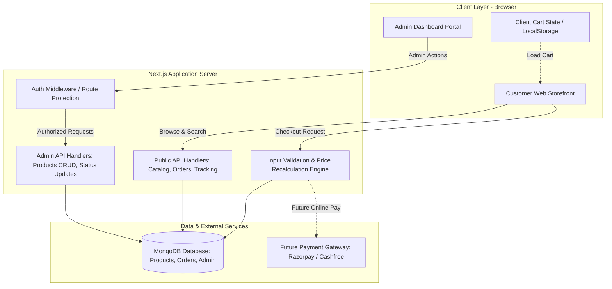
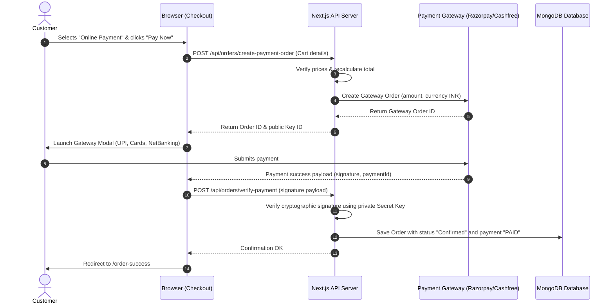

# Sangita Mithai — Technical Architecture Plan

**Document Version:** 1.0.0  
**Status:** Approved for Review (Phase 1: Planning Only)  
**Author:** Software Architect  

---

## 1. Introduction & Beginner's Technical Overview

This document describes the software architecture, database design, security measures, and technical integration plans for **Sangita Mithai**.

### 💡 Beginner's Primer to Key Concepts
If you are new to web development, here is how the technical pieces fit together:
- **Framework (Next.js):** Think of Next.js as the foundation and framing of a house. It combines React (which builds the visual buttons and forms) with a built-in server (which handles data storage and security) in one unified system.
- **TypeScript:** A stricter version of JavaScript that catches spelling errors and data mistakes before the code even runs, preventing unexpected website crashes.
- **Database (MongoDB):** A document database that stores information in flexible records resembling digital index cards (JSON documents) rather than rigid spreadsheets.
- **ODM (Mongoose):** A library that sets clear rules for what information must be included on each MongoDB index card (for example: ensuring every sweet has a name and price).
- **Environment Variables (`.env.local`):** A private text file on your local machine containing secret passwords and connection keys. It is never uploaded to public code repositories like GitHub.
- **API Route:** A secure internal pathway where the browser asks the server to save an order, check a price, or log in an admin.

---

## 2. Proposed Technology Stack

| Layer | Chosen Technology | Rationale & Compatibility |
| :--- | :--- | :--- |
| **Frontend Framework** | **Next.js 16 (App Router)** | Industry standard for high-performance React web applications; supports server rendering, fast page loads, and built-in image optimization. |
| **UI Library** | **React 19** | Component-driven UI that allows reusable product cards, modals, and reactive cart counters. |
| **Programming Language** | **TypeScript 5** | Strict typing for product units, prices, order statuses, and API responses to eliminate runtime errors. |
| **Styling** | **Vanilla CSS & CSS Modules** | Clean, fast, zero-dependency custom styling tailored to our royal Indian sweets palette without bloat. |
| **Icons** | **Lucide React** | Lightweight, modern icon set for shopping carts, search magnifying glasses, stars, and delivery trucks. |
| **Database** | **MongoDB** | Highly flexible document database well-suited for varied product configurations (weights vs. pieces) and complex nested orders. |
| **Data Modeling** | **Mongoose 9** | Enforces schemas, data validation rules, and indexes on MongoDB collections. |
| **Configuration** | **`.env.local`** | Secure local storage of private database URIs and authentication secrets. |

---

## 3. High-Level Architecture

The following diagram illustrates how customer requests and administrative actions travel through the system:



### 3.1 Responsibilities Breakdown

#### Frontend (Client) Responsibilities:
1. Render fast, responsive product cards and category filters.
2. Maintain the customer's active cart state using React Context and `localStorage`.
3. Provide instant visual feedback (quantity toggling, subtotal adjustments).
4. Perform basic form validation (e.g., checking if an entered phone number has 10 digits before sending).
5. Guide the customer through order confirmation and tracking.

#### Backend (Server) Responsibilities:
1. **Never trust client prices:** Retrieve true product prices from MongoDB and compute order totals on the server.
2. Validate delivery zone eligibility using the customer's PIN code.
3. Generate tamper-proof Order Reference IDs (e.g., `#SM-1042`).
4. Authenticate the shop owner via secure HTTP-only cookies and reject unauthorized attempts to access `/admin`.
5. Provide private, verified access to order tracking (checking both Order ID and Phone Number).

---

## 4. Proposed Database Entities & Schema Plan

*Note: This is a planning schema. Actual Mongoose code will be implemented in Phase 4.*

### 4.1 Product Entity (`products`)
Stores each sweet in the 13-product catalog along with its custom quantity options:

```typescript
interface IWeightOption {
  label: string;       // e.g., "250g", "500g", "1kg", "4 pcs", "1 box"
  price: number;       // e.g., 320 (in INR ₹)
}

interface IProduct {
  _id: string;
  name: string;                // e.g., "Kaju Katli"
  slug: string;                // e.g., "kaju-katli"
  category: string;            // e.g., "dry-fruit-sweets"
  description: string;         // Full mouth-watering narrative
  shortDescription: string;    // Brief card summary
  price: number;               // Base starting price
  compareAtPrice?: number;     // Optional strikethrough MRP for discounts
  images: string[];            // File paths e.g., ["/images/kaju-katli.webp"]
  ingredients: string[];       // e.g., ["Cashews", "Sugar", "Silver Leaf"]
  weightOptions: IWeightOption[]; // Flexible portion options
  isFeatured: boolean;         // Displayed on homepage hero/highlights
  isBestSeller: boolean;       // Shown with a "Bestseller" ribbon
  isAvailable: boolean;        // In-stock toggle for the owner
  stock?: number;              // Approximate units available
  tags: string[];              // ["Diwali", "Ghee", "Prasad"]
  createdAt: Date;
  updatedAt: Date;
}
```

### 4.2 Order Entity (`orders`)
Records every placed order, including snapshot prices so future price changes do not distort historic order records:

```typescript
interface IOrderItem {
  productId: string;           // Reference to Product
  name: string;                // Snapshot of sweet name
  selectedOption: string;      // Snapshot of chosen portion (e.g., "500g")
  unitPrice: number;           // Snapshot of price per portion at time of order
  quantity: number;            // Number of portions ordered
  lineTotal: number;           // unitPrice * quantity
}

interface ICustomerDetails {
  name: string;                // Customer full name
  phone: string;               // 10-digit Indian phone number
  address: string;             // Street and house number
  landmark?: string;           // Optional landmark
  city: string;                // City name
  pincode: string;             // 6-digit PIN code
  deliveryNotes?: string;      // Special notes (e.g., "Deliver before 6 PM")
}

interface IOrder {
  _id: string;
  orderNumber: string;         // Friendly reference, e.g., "SM-1042"
  customer: ICustomerDetails;
  items: IOrderItem[];
  subtotal: number;            // Sum of line items
  deliveryFee: number;         // Configured delivery charge (e.g., ₹0 or ₹40)
  totalAmount: number;         // subtotal + deliveryFee
  paymentMethod: "COD" | "ONLINE";
  paymentStatus: "PENDING" | "PAID" | "FAILED";
  paymentDetails?: {
    gateway?: string;          // "Razorpay", "Cashfree", etc.
    transactionId?: string;
    paidAt?: Date;
  };
  orderStatus: "Pending" | "Confirmed" | "Preparing" | "Out for Delivery" | "Delivered" | "Cancelled";
  statusHistory: Array<{
    status: string;
    timestamp: Date;
    note?: string;
  }>;
  createdAt: Date;
  updatedAt: Date;
}
```

### 4.3 Admin User Entity (`admins`)
Secures administrative access:

```typescript
interface IAdminUser {
  _id: string;
  username: string;            // Admin username (e.g., "sangita_admin")
  passwordHash: string;        // Salted bcrypt password hash
  email: string;
  role: "OWNER";
  lastLogin?: Date;
  createdAt: Date;
}
```

---

## 5. Authentication & Authorization Plan

### 5.1 Admin Authentication Mechanism
1. **Credentials:** The shop owner logs in with a dedicated username/email and password at `/admin/login`.
2. **Password Security:** Passwords are never stored in plaintext; they are hashed using `bcrypt` (12 salt rounds).
3. **Session Cookies:** Upon successful login, the server sets an `httpOnly`, `Secure`, `SameSite=Strict` cookie containing a signed JSON Web Token (JWT) or secure session identifier.
4. **Middleware Protection:** Next.js route middleware checks every incoming request to `/admin/*` and `/api/admin/*`. If a valid token is missing, the request is immediately blocked or redirected to `/admin/login`.

### 5.2 Customer Order Privacy Mechanism
- **The Problem:** If an order URL is simply `/order/1042`, anyone could change the number to `1041` and see other customers' private addresses and telephone numbers.
- **The Solution (Two-Tier Security):**
  1. *Immediate Post-Checkout:* The customer is given a cryptographically random, unguessable temporary token in their browser session to view their fresh order summary.
  2. *Public Order Tracking (`/track-order`):* Customers looking up past orders must provide **both** the Order Reference ID (e.g., `SM-1042`) **and** the matching 10-digit Phone Number. The server checks both before revealing order status.

---

## 6. Environment Variable Plan

All sensitive credentials will be stored strictly in `.env.local` during development and production environment secret managers upon deployment.

```bash
# ==========================================
# Sangita Mithai — Environment Configuration
# ==========================================

# Database Connection (MongoDB)
MONGODB_URI="mongodb+srv://<username>:<password>@cluster0.mongodb.net/sangita_mithai?retryWrites=true&w=majority"

# Security & Sessions
JWT_SECRET="generate-a-secure-random-64-character-secret-key-here"
ADMIN_SESSION_COOKIE="sm_admin_session"

# Shop Delivery Configuration Defaults (to be finalized by owner)
SHOP_DELIVERY_CITY="Local City Placeholder"
SHOP_ALLOWED_PINCODES="110001,110002,110003" # Comma-separated allowed PIN codes
SHOP_DELIVERY_FEE=40
SHOP_FREE_DELIVERY_THRESHOLD=500
SHOP_MIN_ORDER_AMOUNT=150

# Future Payment Gateway Integration (Phase 5)
PAYMENT_GATEWAY_PROVIDER="RAZORPAY" # Options: RAZORPAY, CASHFREE, PHONEPE
PAYMENT_GATEWAY_KEY_ID=""
PAYMENT_GATEWAY_KEY_SECRET=""
PAYMENT_GATEWAY_WEBHOOK_SECRET=""
```

> ⚠️ **Rule:** `.env.local` is listed in `.gitignore` and must **never** be committed to version control.

---

## 7. Payment Integration Plan

### 7.1 Phase 1–4: Cash on Delivery (COD) Focus
- Cash on Delivery is straightforward and traditional for Indian sweets shops.
- When an order is placed with COD:
  1. Payment method is recorded as `"COD"`.
  2. Payment status is set to `"PENDING"`.
  3. Delivery person collects cash at the doorstep.
  4. Shop owner updates the order status to `"Delivered"` and payment status to `"PAID"` in the Admin Dashboard.

### 7.2 Phase 5: Future Online Payment Architecture
When the shop owner decides to enable digital payments (UPI, Credit/Debit cards, Net Banking):



#### Crucial Security Rules for Online Payments:
1. **Never mark an order as paid on the frontend:** Just because the browser redirects to `/order-success` does not mean money was received. The backend must verify the signature or receive a server-to-server webhook.
2. **Never store card numbers:** The website never handles raw 16-digit card numbers or CVVs. All card processing happens inside the gateway's secure, PCI-DSS-compliant iframe.
3. **Sandbox Testing:** The entire flow will be validated in Gateway Test Mode before any real customer money is accepted.

---

## 8. Validation, Error Handling, and Privacy

### 8.1 Input Validation Strategy
- **Phone Number:** Must match `/^[6-9]\d{9}$/` (standard Indian 10-digit mobile phone starting with 6, 7, 8, or 9).
- **PIN Code:** Must match `/^\d{6}$/` (standard 6-digit Indian PIN code).
- **Text Fields:** Stripped of leading/trailing spaces and sanitized against HTML script injection.

### 8.2 Server-Side Error Handling
- Meaningful, polite error messages for customers (e.g., *"We currently deliver sweets only within selected PIN codes"*).
- Internal database error details are logged securely to the server console and **never** exposed to the customer's browser.

---

## 9. Testing Strategy (Phased Approach)

1. **Unit & Logic Tests (Phase 4):**
   - Verify cart subtotal and discount calculations.
   - Verify PIN code lookup function.
2. **Component & Responsive UI Testing (Phase 2 & 3):**
   - Test layout on iPhone (375px), Android (412px), iPad (768px), and Laptop (1440px).
   - Test keyboard navigation across dropdowns and buttons.
3. **End-to-End Flow Testing (Phase 5 & 6):**
   - Complete checkout path with COD order placement.
   - Test Admin status update cycle (Pending → Confirmed → Preparing → Out for Delivery → Delivered).
   - Test privacy wall: ensure unauthorized users cannot peek at order data.
