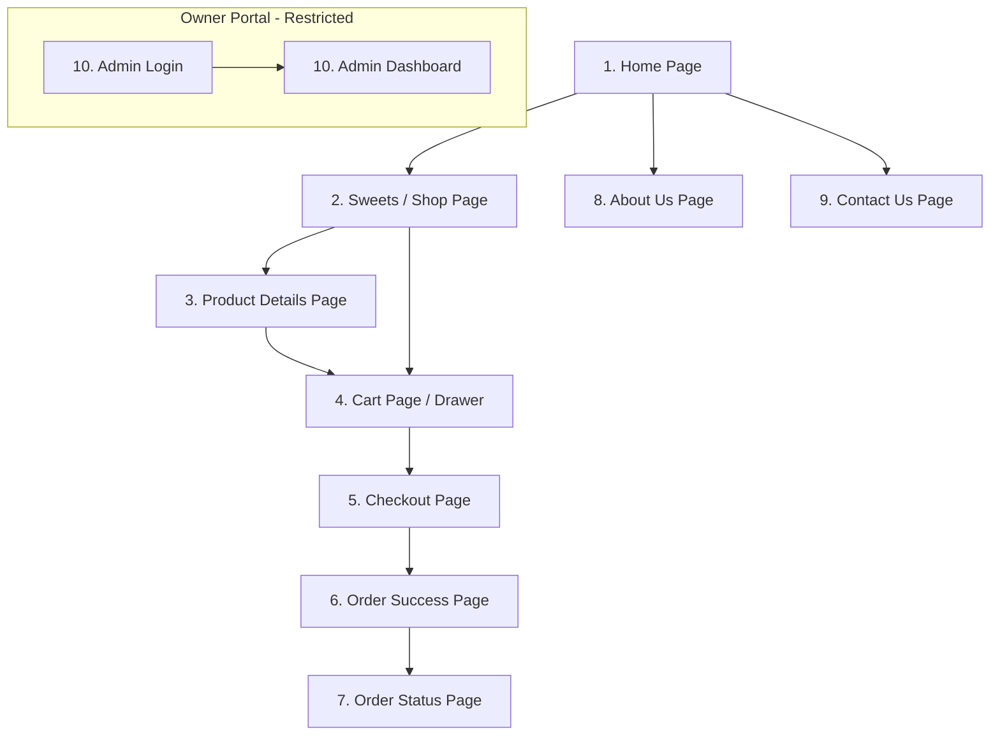

# Sangita Mithai — UI/UX Design Brief

**Document Version:** 1.0.0  
**Status:** Approved for Review (Phase 1: Planning & Architecture Only)  
**Author:** UI/UX Lead & Design Systems Architect  
**Scope:** Brand Identity, Design System Tokens, Component Specifications, Responsive Layouts, and Page-by-Page Wireframes  

---

## 1. Brand Identity & Visual Philosophy

### 1.1 Brand Essence
**Sangita Mithai (संगीता मिठाई)** is a premier artisan Indian sweet emporium that bridges centuries-old confectionery craftsmanship with effortless, modern digital ordering.

- **Warmth & Hospitality (*Atithi Devo Bhava*):** The website creates the emotional warmth and hospitality of stepping into a traditional sweet shop filled with the aroma of freshly cooked cardamom, saffron, and pure desi cow ghee.
- **Festive Elegance Without Clutter:** Celebrates traditional Indian festive aesthetics through rich royal vermilion, auspicious saffron orange, warm milk cream, and light yellow tones, paired with clean whitespace and modern layout discipline.
- **Appetizing Culinary Purity:** Crisp, appetizing visual presentation showcases glistening ghee, golden fried textures, delicate edible silver foil (*chandi vark*), and 100% vegetarian ingredients.
- **Trustworthy & Transparent:** Clear portion sizes (grams, pieces, gift hampers), real-time pricing without hidden surprises, and a simple guest checkout process build trust for customers of all ages.

### 1.2 Visual Styling Rules
1. **Balance Heritage with Modernity:** Use traditional Indian decorative motifs (delicate arch curves, subtle gold dividers, diya accents) sparingly as accents rather than heavy backgrounds.
2. **Generous Breathing Room:** Avoid visual overcrowding. Keep product cards distinct, forms spacious, and navigation intuitive.
3. **Food-First Photography:** Sweet imagery is the hero of the website. High-contrast cards with warm lighting make every item look fresh and mouth-watering.

---

## 2. Color Palette & Design Tokens

The color palette is derived directly from authentic Indian sweet ingredients: pure cow ghee, saffron (*kesar*), pistachio, milk solids (*khoya* and *rabdi*), and edible silver foil.

```
+-------------------------------------------------------------------------------------------------------+
|  Primary Vermilion   |  Saffron Gold    |  Cardamom Amber  |  Rabdi Yellow    |  Warm Ghee Cream     |
|       #991B1B        |     #D97706      |     #F59E0B      |     #FEF9C3      |       #FFFDF7        |
+-------------------------------------------------------------------------------------------------------+
|  Pure Veg Green      |  Crimson Alert   |  Info Sky Blue   |  Charcoal Main   |  Slate Muted Text    |
|       #15803D        |     #DC2626      |     #0369A1      |     #1E1E24      |       #64748B        |
+-------------------------------------------------------------------------------------------------------+
```

### 2.1 Named Color Tokens Table

| Token Name | Hex Code | Semantic Role & Practical Application | WCAG Contrast Ratio |
| :--- | :--- | :--- | :--- |
| `--color-primary` | `#991B1B` | **Royal Vermilion:** Primary brand color for primary CTA buttons, active navigation markers, and hero accents. | 6.4:1 on white (AA) |
| `--color-primary-hover` | `#7F1D1D` | **Deep Garnet:** Hover and pressed states for primary buttons. | 8.8:1 on white (AAA) |
| `--color-primary-light` | `#FEE2E2` | **Blush Tint:** Light background for active filters or subtle vermilion callouts. | N/A (Surface) |
| `--color-secondary` | `#D97706` | **Festive Saffron:** Secondary CTA buttons, highlight ribbons, and festive announcement strips. | 5.1:1 on dark text (AA) |
| `--color-secondary-hover`| `#B45309` | **Roasted Saffron:** Hover and pressed states for secondary buttons. | 6.8:1 on white (AA) |
| `--color-secondary-light`| `#FFEDD5` | **Soft Saffron Cream:** Background tint for promo chips and festive callouts. | N/A (Surface) |
| `--color-accent` | `#F59E0B` | **Cardamom Amber:** Decorative borders, rating stars, award badges, and festive accents. | N/A (Accent) |
| `--color-accent-light` | `#FEF3C7` | **Light Khoya Amber:** Background fill for selected portion pills and bestseller badges. | N/A (Surface) |
| `--color-bg-page` | `#FFFDF7` | **Warm Ghee Cream:** Primary page background color; soft on the eyes, replaces stark digital white. | 14.8:1 with `#1E1E24` (AAA) |
| `--color-surface-card` | `#FFFFFF` | **Pure Chhena White:** Product cards, dialog modals, dropdowns, and form input backgrounds. | 15.6:1 with `#1E1E24` (AAA) |
| `--color-bg-subtle` | `#FEF9C3` | **Rabdi Light Yellow:** Light yellow background for notification bars, special festival deals, and highlights. | N/A (Surface) |
| `--color-surface-muted` | `#FBF8EE` | **Muted Ghee Tint:** Table headers, unselected item panels, and input placeholder surfaces. | N/A (Surface) |
| `--color-text-main` | `#1E1E24` | **Charcoal Espresso:** Primary high-contrast body text, headings, and prominent product titles. | 14.8:1 on cream (AAA) |
| `--color-text-secondary`| `#64748B` | **Cardamom Ash:** Secondary descriptions, delivery estimates, ingredients list, and helper text. | 4.6:1 on white (AA) |
| `--color-text-inverse` | `#FFFFFF` | **Pure White:** Text on dark buttons (Primary Vermilion) and header announcement strips. | 6.4:1 on `#991B1B` (AA) |
| `--color-border-subtle` | `#F1E5D1` | **Cream Divider:** Hairline card outlines, horizontal rules, and table borders. | Non-text UI (AA) |
| `--color-border-medium` | `#E2D5BE` | **Tan Border:** Form input borders in default resting state. | Non-text UI (AA) |
| `--color-border-focus` | `#D97706` | **Saffron Focus Ring:** High-visibility outline for keyboard accessibility (`:focus-visible`). | Non-text UI (AA) |
| `--color-success` | `#15803D` | **Pure Veg Green:** 100% vegetarian emblem, valid PIN checkmarks, and order confirmation states. | 5.2:1 on white (AA) |
| `--color-success-bg` | `#DCFCE7` | **Mint Cream:** Background fill for positive alerts, status pills, and verified delivery notices. | N/A (Surface) |
| `--color-success-border`| `#86EFAC` | **Light Emerald Border:** Border for success callouts and valid input feedback. | Non-text UI (AA) |
| `--color-warning` | `#B45309` | **Amber Saffron:** Low stock alerts, shelf-life advisories, and pending order status markers. | 5.1:1 on white (AA) |
| `--color-warning-bg` | `#FEF3C7` | **Light Amber:** Background fill for warning alert boxes. | N/A (Surface) |
| `--color-warning-border`| `#FDE68A` | **Gold Border:** Outline for warning banners. | Non-text UI (AA) |
| `--color-info` | `#0369A1` | **Royal Sky Blue:** Informational callouts (e.g., preparation time guide, COD guidelines). | 4.8:1 on white (AA) |
| `--color-info-bg` | `#E0F2FE` | **Sky Tint:** Background fill for informational helper banners. | N/A (Surface) |
| `--color-info-border` | `#BAE6FD` | **Soft Sky Border:** Outline for informational notices. | Non-text UI (AA) |
| `--color-error` | `#DC2626` | **Crimson Alert:** Form validation errors, out-of-delivery-zone notices, and sold-out badges. | 4.7:1 on white (AA) |
| `--color-error-bg` | `#FEE2E2` | **Soft Blush:** Background fill for validation error banners and input error highlights. | N/A (Surface) |
| `--color-error-border` | `#FECACA` | **Light Crimson Border:** Outline for invalid input fields and alert containers. | Non-text UI (AA) |

### 2.2 Text Contrast & Accessibility Matrix
1. **Normal Body Text:** Requires at least 4.5:1 contrast against background (WCAG AA). `#1E1E24` on `#FFFDF7` achieves **14.8:1** (exceeds AAA).
2. **Primary Button Text:** `#FFFFFF` on `#991B1B` achieves **6.4:1** (exceeds AA).
3. **Secondary Saffron Button Text:** Paired with dark text `#1E1E24` on `#D97706` achieving **5.1:1** (exceeds AA). White text is strictly forbidden on saffron backgrounds.
4. **Secondary Text:** `#64748B` on `#FFFFFF` achieves **4.6:1** (passes AA).
5. **Vegetarian Indicator:** `#15803D` on `#FFFFFF` achieves **5.2:1** (passes AA).

---

## 3. Typography System (English & Hindi Support)

The typography pairs regal heritage serif typefaces with clean, high-legibility modern sans-serifs, providing native script harmony for English and Hindi (Devanagari).

```
+---------------------------------------------------------------------------------------------+
| Heading Font Family (Display, Festive Titles & Section Headers)                             |
| English: 'Cinzel', Georgia, serif                                                           |
| Hindi: 'Rozha One', 'Tiro Devanagari Hindi', serif                                          |
+---------------------------------------------------------------------------------------------+
| Body & UI Font Family (Cards, Inputs, Buttons, Navigation, Labels, Prices)                  |
| English: 'Outfit', 'Inter', system-ui, sans-serif                                           |
| Hindi: 'Noto Sans Devanagari', sans-serif                                                   |
+---------------------------------------------------------------------------------------------+
```

### 3.1 Type Scale Hierarchy Table

| Style Token | Font Family | Size (Desktop) | Size (Mobile) | Weight | Line Height | Usage |
| :--- | :--- | :--- | :--- | :--- | :--- | :--- |
| `display-hero` | `'Cinzel'` / `'Rozha One'` | 44px (2.75rem) | 30px (1.875rem) | 700 Bold | 1.15 | Homepage hero banner title. |
| `h1-section` | `'Cinzel'` / `'Rozha One'` | 32px (2.00rem) | 24px (1.500rem) | 700 Bold | 1.25 | Major page titles (Shop, About Us, Admin). |
| `h2-title` | `'Outfit'` / `'Noto Sans'` | 22px (1.375rem) | 19px (1.187rem) | 600 SemiBold| 1.30 | Product details title, section headers, modal titles. |
| `h3-card` | `'Outfit'` / `'Noto Sans'` | 18px (1.125rem) | 16px (1.000rem) | 600 SemiBold| 1.35 | Product card sweet name in catalog grid. |
| `body-lead` | `'Outfit'` / `'Noto Sans'` | 18px (1.125rem) | 16px (1.000rem) | 400 Regular | 1.50 | Intro paragraphs, hero subheadlines. |
| `body-main` | `'Outfit'` / `'Noto Sans'` | 16px (1.000rem) | 15px (0.937rem) | 400 Regular | 1.50 | Product descriptions, cart line items, narrative. |
| `body-sm` | `'Outfit'` / `'Noto Sans'` | 14px (0.875rem) | 13px (0.812rem) | 400 Regular | 1.45 | Delivery instructions, ingredient lists, table rows. |
| `caption` | `'Outfit'` / `'Noto Sans'` | 12px (0.750rem) | 11px (0.687rem) | 500 Medium | 1.35 | Category tags, allergen advisories, helper notes. |
| `price-hero` | `'Outfit'` (Tabular) | 30px (1.875rem) | 24px (1.500rem) | 700 Bold | 1.10 | Large price on Product Details page. |
| `price-card` | `'Outfit'` (Tabular) | 19px (1.187rem) | 17px (1.062rem) | 700 Bold | 1.20 | Rupee price on product cards (`#991B1B`). |
| `price-mrp` | `'Outfit'` (Tabular) | 14px (0.875rem) | 13px (0.812rem) | 400 Regular | 1.20 | Strikethrough compare-at price (`#64748B`). |
| `label-form` | `'Outfit'` / `'Noto Sans'` | 14px (0.875rem) | 14px (0.875rem) | 600 SemiBold| 1.25 | Form input labels (PIN Code, Mobile Number). |
| `button-text`| `'Outfit'` / `'Noto Sans'` | 15px (0.937rem) | 14px (0.875rem) | 600 SemiBold| 1.00 | Primary and secondary action buttons, tabs. |

### 3.2 Mobile Readability & Script Optimization Rules
1. **Prevent iOS Auto-Zoom:** All form input elements (`<input>`, `<select>`, `<textarea>`) must use a minimum font size of **16px** on mobile viewports so iOS Safari does not zoom the viewport on touch focus.
2. **Tabular Numerals:** All price displays, weights, item counters, and order totals must specify `font-variant-numeric: tabular-nums` to ensure numbers align neatly without horizontal layout shifts.
3. **Devanagari Vowel Diacritic Padding:** Devanagari script features tall ascenders (matras like *matra ee* and *chandrabindu*). Heading elements supporting Hindi must have adequate line-height (`1.25` to `1.35`) and `padding-top` to avoid clipping glyph heads.

---

## 4. Spacing, Elevation & Layout Grid (4px Grid Scale)

The entire design system is built on an exact **4px geometric grid** (`n * 4px`), providing rhythm, proportional spacing, and consistent alignment.

### 4.1 Spacing Scale Tokens

| Token | Pixel Value | Rem Equivalent | Primary UI Application |
| :--- | :--- | :--- | :--- |
| `--space-1` | `4px` | `0.25rem` | Micro badge padding, inline icon-text spacing. |
| `--space-2` | `8px` | `0.50rem` | Space between sweet title and subtitle; button icon gap. |
| `--space-3` | `12px` | `0.75rem` | Inside padding for portion selector pills, input vertical padding. |
| `--space-4` | `16px` | `1.00rem` | Default component padding, mobile screen gutters, card padding. |
| `--space-5` | `20px` | `1.25rem` | Spacing between form fields, gaps in mobile sweet cards. |
| `--space-6` | `24px` | `1.50rem` | Card grid gaps on tablet, modal inner padding. |
| `--space-7` | `28px` | `1.75rem` | Spacing between major card groups, filter bar margin. |
| `--space-8` | `32px` | `2.00rem` | Section gaps on mobile, desktop screen horizontal gutters. |
| `--space-10`| `40px` | `2.50rem` | Spacing below page titles, table container margins. |
| `--space-12`| `48px` | `3.00rem` | Section gaps on desktop, space below hero banner. |
| `--space-16`| `64px` | `4.00rem` | Major page section dividers on desktop storefront. |
| `--space-20`| `80px` | `5.00rem` | Hero banner vertical padding. |

### 4.2 Page Containers & Responsive Breakpoints

```
[ Mobile: 360px - 639px ]  --> Gutters: 16px | 1 Column Grid (2 compact > 480px)
[ Tablet: 640px - 1023px ] --> Gutters: 24px | 2 Column Grid
[ Desktop: 1024px - 1279px] --> Gutters: 32px | 3 Column Grid | 2-Col Checkout
[ Wide Desktop: 1280px+ ]   --> Max Width: 1280px | 4 Column Grid
```

- **Maximum Site Container (`--container-max`):** `1280px` with automatic left and right centering margins (`margin: 0 auto;`).
- **Narrow Container (`--container-narrow`):** `768px` for focused single-column pages (Checkout, Order Tracking, Admin Login).
- **Horizontal Screen Gutters:**
  - Mobile: `16px` (`--space-4`)
  - Tablet: `24px` (`--space-6`)
  - Desktop: `32px` (`--space-8`)
- **Responsive Breakpoint Matrix:**
  - `sm`: `640px` (Tablet transition)
  - `md`: `768px` (Header switch from bottom nav to top menu)
  - `lg`: `1024px` (Desktop 3-column catalog & 2-column checkout)
  - `xl`: `1280px` (Max-width container boundary & 4-column catalog)

### 4.3 Border Radius Tokens
```css
:root {
  --radius-xs: 4px;      /* Allergen tags, veg badge square */
  --radius-sm: 8px;      /* Form inputs, portion selector pills, buttons */
  --radius-md: 12px;     /* Product cards, modal dialogs, review boxes */
  --radius-lg: 20px;     /* Hero containers, festive highlight banners */
  --radius-full: 9999px; /* Cart count badge, floating pills, quantity circular buttons */
}
```

### 4.4 Elevation & Shadows
Shadows incorporate a delicate warm vermilion undertone (`rgba(153, 27, 27, ...)`) instead of cold gray, providing ambient warmth:
```css
:root {
  --shadow-sm: 0 1px 3px rgba(30, 30, 36, 0.05);
  --shadow-card: 0 4px 16px -2px rgba(153, 27, 27, 0.08);
  --shadow-card-hover: 0 12px 28px -4px rgba(153, 27, 27, 0.16);
  --shadow-modal: 0 20px 40px -8px rgba(30, 30, 36, 0.25);
  --shadow-bottom-nav: 0 -4px 16px rgba(30, 30, 36, 0.08);
}
```

### 4.5 Touchscreen Comfort & Target Sizing
- **44px Minimum Rule:** Every interactive control (buttons, portion pills, quantity steppers, checkbox targets, header links) must provide a hit target of at least **44px × 44px**.
- **Touch Spacing:** Interactive elements must have at least **8px** (`--space-2`) separation to eliminate accidental misclicks on touchscreen devices.

---

## 5. Reusable UI Components & State Matrix

Every component has defined specifications for all UI states: **Default, Hover, Active/Pressed, Disabled, Keyboard Focus (`:focus-visible`), Loading, Empty, Error, and Success**.

### 5.1 Component Interaction States Matrix

| Component | Default State | Hover State | Active / Pressed | Disabled State | Keyboard Focus (`:focus-visible`) |
| :--- | :--- | :--- | :--- | :--- | :--- |
| **Primary Button** | Background: `#991B1B`<br>Text: `#FFFFFF`<br>Radius: `8px`<br>Height: `44px` | Background: `#7F1D1D`<br>Transform: `translateY(-1px)` | Background: `#5F1414`<br>Transform: `translateY(0)` | Background: `#E2E8F0`<br>Text: `#94A3B8`<br>Cursor: `not-allowed` | Outline: `2px solid #D97706`<br>Offset: `2px` |
| **Secondary Button** | Background: `#D97706`<br>Text: `#1E1E24`<br>Weight: `600` | Background: `#B45309`<br>Text: `#FFFFFF` | Background: `#92400E`<br>Text: `#FFFFFF` | Background: `#E2E8F0`<br>Text: `#94A3B8` | Outline: `2px solid #991B1B`<br>Offset: `2px` |
| **Outline Button** | Border: `1.5px solid #991B1B`<br>Text: `#991B1B`<br>Bg: `transparent` | Bg: `#FEE2E2`<br>Text: `#7F1D1D` | Bg: `#FECACA` | Border: `1px solid #E2E8F0`<br>Text: `#94A3B8` | Outline: `2px solid #D97706`<br>Offset: `2px` |
| **Portion Selector Pill** | Border: `1px solid #F1E5D1`<br>Bg: `#FFFFFF`<br>Text: `#1E1E24` | Border: `1px solid #D97706`<br>Bg: `#FFFDF7` | **Selected:**<br>Border: `2px solid #991B1B`<br>Bg: `#FEF3C7`<br>Text: `#991B1B` | Opacity: `0.4`<br>Pointer-events: `none` | Outline: `2px solid #D97706`<br>Offset: `1px` |
| **Form Input Field** | Border: `1px solid #E2D5BE`<br>Bg: `#FFFFFF`<br>Height: `48px` | Border: `1px solid #D97706` | Border: `2px solid #991B1B` | Bg: `#F8FAFC`<br>Border: `1px solid #E2E8F0`<br>Text: `#94A3B8` | Outline: `2px solid #D97706`<br>Offset: `0` |
| **Product Card** | Bg: `#FFFFFF`<br>Border: `1px solid #F1E5D1`<br>Shadow: `--shadow-card` | Border: `1px solid #D97706`<br>Shadow: `--shadow-card-hover`<br>Image zooms `1.03` | N/A | Grayed out `opacity: 0.7`<br>With "Sold Out" overlay | Card wrapper gets 2px gold focus ring on tab |
| **Quantity Stepper** | `[-] [qty] [+]`<br>Border: `1px solid #F1E5D1`<br>Height: `36px` | Button Bg: `#FEF3C7`<br>Text: `#991B1B` | Button Bg: `#FDE68A` | Disabled `[-]` when qty=1 (or shows trash) | Button receives 2px focus ring |

---

### 5.2 Header, Logo, Navigation & Mobile Bottom Bar

```
+---------------------------------------------------------------------------------------------------------------+
| Top Strip: 🚚 Fresh Sweet Delivery within City Limits | Call/WhatsApp: [Phone TBD]   | 100% Pure Desi Ghee    |
+---------------------------------------------------------------------------------------------------------------+
| [ SANGITA MITHAI ]          [Home]  [Shop Sweets]  [About Us]  [Contact Us]           [ 🔍 Search ]  [ 🛒 Cart (3) ] |
|  संगीता मिठाई • Pure Ghee                                                                                     |
+---------------------------------------------------------------------------------------------------------------+
```

1. **Top Announcement Strip:**
   - Background: Saffron Gold (`#D97706`).
   - Text: White (`#FFFFFF`), 12px, font-weight 500.
   - Message: *"🚚 Fresh Sweet Delivery within City Limits | WhatsApp: [TBD by owner] | 100% Pure Desi Ghee"*.
2. **Brand Logo Mark:**
   - Dual-line typographical branding:
     - Primary Line: **Sangita Mithai** in `'Cinzel'` serif, font-weight 700, Royal Vermilion (`#991B1B`), 22px desktop / 18px mobile.
     - Subtitle Line: **संगीता मिठाई • PURE DESI GHEE** in Saffron Gold (`#D97706`), 11px uppercase, font-weight 600.
3. **Desktop Navigation Links:**
   - Links: *Home*, *Shop Sweets*, *About Us*, *Contact Us*.
   - Active Indicator: Deep vermilion underline bar (`2px solid #991B1B`).
   - Hover Indicator: Text transitions to Saffron Gold (`#D97706`).
4. **Header Utility Actions:**
   - **Search Trigger Button:** Opens an accessible, debounced search bar modal or inline expander.
   - **Cart Pill Badge:** Displays shopping bag icon, active item count badge in vermilion, and live subtotal preview (`🛒 3 items - ₹680`).
5. **Mobile Sticky Bottom Navigation Bar (< 768px Viewports):**
   - Fixed to screen bottom, height: `60px`, background: `#FFFFFF`, border-top: `1px solid #F1E5D1`, shadow: `--shadow-bottom-nav`.
   - 4 thumb-accessible tabs with 44px hit targets:
     1. 🏠 **Home** (`/`)
     2. 🍬 **Shop** (`/shop`)
     3. 🛒 **Cart** (`/cart`) — Includes floating vermilion circular item count badge.
     4. 🚚 **Track** (`/track-order`)

---

### 5.3 Product Card Anatomy & Sweet Images

The product card is the central shopping unit, engineered for clarity, portion flexibility, and instant appetite appeal:

```
+-------------------------------------------------------------------------+
| [ 🌿 Pure Veg ]                                   [ ⭐ Bestseller Ribbon ] |
|                                                                         |
|                         [ 1:1 Product Photo ]                           |
|                      (Glistening Kaju Katli)                            |
|                                                                         |
|-------------------------------------------------------------------------|
| Kaju Katli                                              [ Dry Fruit ]   |
| Diamond-cut Goan cashew fudge with pure vegetarian silver leaf.         |
|                                                                         |
| Portion:                                                                |
| [ (250g) ]       [ 500g ]       [ 1kg ]                                 |
|                                                                         |
| ₹320  <span class="mrp">₹350</span>                                    |
|                                                      [ + Add to Box ]   |
+-------------------------------------------------------------------------+
```

1. **Card Container:**
   - Background: Pure White (`#FFFFFF`).
   - Border: `1px solid #F1E5D1`.
   - Radius: `12px` (`--radius-md`).
   - Padding: `16px` (`--space-4`).
   - Hover Transition: Elevates with `--shadow-card-hover` and border transitions to Saffron Gold (`#D97706`).
2. **Vegetarian Emblem:**
   - Top-left corner: Standard Indian green dot enclosed in a green square (`#15803D`, 16px × 16px).
   - Screen reader label: `aria-label="100% Pure Vegetarian"`.
3. **Badges & Ribbons:**
   - Optional top-right tag: **"Bestseller"** (Saffron Ribbon `#D97706`) or **"Festive Special"** (Amber Ribbon `#F59E0B`).
4. **Sweet Image Frame:**
   - Strict **1:1 square aspect ratio**.
   - Lazy-loaded WebP image with smooth zoom (`scale(1.03)`) on card hover.
   - Fallback shimmer skeleton during loading.
5. **Portion Selector Radio Pills:**
   - Displays available unit options (e.g., `250g`, `500g`, `1kg` or `4 pcs`, `8 pcs`).
   - Tapping an unselected pill instantly recalculates the price below.
   - Selected state: Deep vermilion border (`#991B1B`), amber background (`#FEF3C7`), and bold text.
6. **Price Display:**
   - Prominent current price in Royal Vermilion (`#991B1B`, 19px bold).
   - Optional compare-at price in strikethrough gray (`#64748B`, 14px regular).
7. **"Add to Box / Add to Cart" Button:**
   - Full-width or right-aligned primary vermilion button with shopping bag icon.
   - Provides gentle click bounce animation and triggers header cart badge increment.
8. **Sold Out State:**
   - If `isAvailable: false`, card receives a semi-transparent gray overlay (`opacity: 0.7`), a centered bold crimson **"Sold Out"** badge, and the "Add" button is disabled.

---

### 5.4 Search Box & Category Filter Pills

1. **Search Box:**
   - Height: `44px`, background: `#FFFFFF`, border: `1px solid #E2D5BE`, border-radius: `8px`.
   - Leading icon: Lucide Search magnifying glass in muted gray (`#64748B`).
   - Trailing action: Clean "X" button to clear search input.
   - Real-time client-side filter with 250ms debounce against sweet name, category, and tags.
2. **Category Filter Tabs:**
   - Horizontally scrollable row on mobile with hidden scrollbar.
   - Filter items: `All Sweets`, `Milk Sweets`, `Bengali Sweets`, `Dry Fruit Sweets`, `Traditional Mithai`, `Gift Boxes`.
   - Default pill: Cream background (`#FFFFFF`), border `1px solid #F1E5D1`.
   - Active pill: Royal vermilion background (`#991B1B`), white text (`#FFFFFF`), font-weight 600.

---

### 5.5 Cart Items, Drawer & Order Totals

```
+-------------------------------------------------------------------------+
| [Photo]  Kaju Katli                                                     |
|          Portion: 500g  •  ₹620 each                                    |
|          [ - ]  [ 2 ]  [ + ]                            ₹1,240  [ 🗑️ ]  |
+-------------------------------------------------------------------------+
| Subtotal:                                                       ₹1,240  |
| Delivery:                                                        FREE   |
| (🎉 You unlocked FREE delivery on this order!)                          |
| ----------------------------------------------------------------------- |
| Total Amount:                                                   ₹1,240  |
|                                            [ Proceed to Checkout → ]    |
+-------------------------------------------------------------------------+
```

1. **Line Item Structure:**
   - Thumbnail sweet photo (60px × 60px rounded).
   - Sweet name and portion pill badge (e.g., `500g`).
   - Unit price (`₹620`).
   - Quantity Stepper `[-] [2] [+]` with minimum 1 and maximum 20.
   - Line total calculated dynamically (`₹1,240`).
   - Remove icon button (trash icon in muted red) with confirmation safeguard if quantity reaches zero.
2. **Order Totals Card:**
   - Item Subtotal: Sum of all line totals.
   - Delivery Fee: Clearly displays configured rate (e.g., `₹40`) or `FREE`.
   - Free Delivery Progress Meter: Dynamic bar showing *"Add ₹80 more to get FREE Delivery!"*.
   - Grand Total: Large bold typography in `#1E1E24`.
   - Primary Action CTA: **"Proceed to Checkout"** (Vermilion button, 48px height).

---

### 5.6 Form Inputs, Validation & Feedback States

1. **Form Input Anatomy:**
   - Label placed permanently above the field in font-weight 600, 14px (`#1E1E24`).
   - Field container: 48px height, rounded corners (`8px`), border `1px solid #E2D5BE`.
   - Clear placeholder text in `#94A3B8`.
2. **Valid Input State:**
   - Border transitions to Pure Veg Green (`#15803D`).
   - Trailing checkmark icon (`CheckCircle`) appears on the right edge.
3. **Invalid / Error State:**
   - Border transitions to Crimson Alert (`#DC2626`).
   - Background fills with Soft Blush (`#FEE2E2`).
   - Trailing warning icon (`AlertCircle`) appears.
   - Descriptive helper message displayed in red text directly beneath field (e.g., *"Please enter a valid 10-digit mobile number starting with 6, 7, 8, or 9"*).
4. **Never Rely on Color Alone:** Every error or alert pairs color with both an identifiable icon and explicit text.

---

### 5.7 Order Status Badges & Progress Stepper

The visual milestone stepper translates order states into a traditional customer fulfillment journey:

```
(✓) Received  =====>  (✓) Confirmed  =====>  (●) Kitchen Prep  =====>  (○) On the Way  =====>  (○) Delivered
```

1. **Milestone Stages:**
   - Milestone 1: **Order Received** (`Pending`)
   - Milestone 2: **Confirmed** (`Confirmed`)
   - Milestone 3: **Kitchen Prep** (`Preparing`)
   - Milestone 4: **On the Way** (`Out for Delivery`)
   - Milestone 5: **Delivered** (`Delivered`)
2. **Visual Status Styling:**
   - **Completed Milestone:** Filled circle with white checkmark on Veg Green (`#15803D`) and solid green connecting line.
   - **Active Milestone:** Pulsing Royal Vermilion circle (`#991B1B`), bold label, and estimated completion time.
   - **Upcoming Milestone:** Neutral border circle (`#E2D5BE`) with muted gray text (`#64748B`).
   - **Cancelled State:** Replaces stepper with a Soft Blush warning banner (`#FEE2E2`), crimson cross mark (`#DC2626`), and shop contact telephone.

---

### 5.8 Global UI States Specifications

| UI State | Visual Treatment & Behavior |
| :--- | :--- |
| **Loading State** | Shimmering skeleton cards with soft warm gradient (`#FBF8EE` to `#FEF3C7`) matching the exact geometry of product cards to eliminate layout shifts (CLS = 0). Buttons display inline spinner. |
| **Empty State** | **Empty Cart:** Warm illustration of an empty festive brass sweet thali with headline *"Your sweet box is empty!"* and secondary text *"Add some fresh motichoor ladoos or kaju katli to begin your celebration."* CTA: **"Browse Sweets"**.<br>**No Search Results:** Friendly icon with *"No sweets found matching '[query]'"* and a **"Clear Search"** button. |
| **Success State** | Festive gold confetti accent, green checkmark icon, and celebratory copy: *"Dhanyavaad! Your order has been placed successfully."* Provides distinct Order Reference ID. |
| **Error State** | Non-intrusive callout banner with red border (`#DC2626`), light blush background (`#FEE2E2`), error exclamation icon, and clear corrective advice. |
| **Disabled State** | Element opacity reduced to `0.4`–`0.5`, background muted to `#E2E8F0`, text color `#94A3B8`, `cursor: not-allowed`, and `pointer-events: none`. |

---

## 6. Page-by-Page Visual Layout & Key Actions

Detailed visual structure, wireframe layouts, and primary actions for all **10 website pages** in strict accordance with [APP-FLOW.md](file:///c:/Users/DELL/OneDrive/Documents/sangita%20mithai/APP-FLOW.md).



---

### 6.1 Page 1: Home Page (`/`)

#### Visual Layout & Composition
- **Top Announcement Bar:** Saffron strip with delivery prompt and WhatsApp helpline.
- **Global Header:** Logo mark, navigation links, search trigger, and cart pill counter.
- **Hero Banner Section:**
  - Background: Warm royal vermilion and saffron gradient overlay with subtle festive arch motif.
  - Left Column: Bold regal display headline: *"Pure Desi Ghee Indian Sweets Handcrafted Daily"*, subheadline highlighting tradition and freshness, and dual CTAs:
    - Primary CTA Button: **"Order Sweets Now"** (routes to `/shop`).
    - Secondary Outline Button: **"Explore Gift Boxes"** (routes to `/shop?category=gift-boxes`).
  - Right Column: High-resolution appetizing photograph of a traditional silver thali filled with signature sweets.
- **Purity & Trust Strip (4 Columns):**
  - Card 1: 🌿 *100% Pure Desi Ghee*
  - Card 2: ☀️ *Freshly Prepared Daily*
  - Card 3: 🚫 *Zero Chemical Preservatives*
  - Card 4: 📦 *Hygienic Food-Grade Box Packing*
- **Signature Sweets Section:** 4 curated cards (*Kaju Katli, Motichoor Ladoo, Royal Rasmalai, Gulab Jamun*) with interactive portion selectors.
- **Festive Gift Box Banner:** Full-width gold and amber banner highlighting wedding and festival gift hampers.
- **Customer Reviews Carousel:** Clean white cards with star ratings and authentic customer quotes.
- **Global Footer:** Brand story, quick links, shop opening hours placeholder (*TBD*), and copyright notice.

#### Primary User Actions
- Primary Action: Click **"Order Sweets Now"** to open `/shop`.
- Secondary Action: Add a signature sweet directly to cart from the homepage grid.

---

### 6.2 Page 2: Sweets / Shop Page (`/shop`)

#### Visual Layout & Composition
- **Page Header:** Regal H1 title *"Our Artisan Sweets"* with short description of craftsmanship.
- **Filter & Search Bar (Sticky Below Header):**
  - Integrated search box with 250ms debounced input.
  - Horizontally scrollable category filter pills: `[All]`, `[Milk Sweets]`, `[Bengali Sweets]`, `[Dry Fruit Sweets]`, `[Traditional Mithai]`, `[Gift Boxes]`.
- **Product Catalog Grid:**
  - Responsive layout (1 col mobile, 2 col tablet, 3-4 col desktop).
  - Displays all 13 core sweets:
    1. Kaju Katli (Dry Fruit Sweets)
    2. Gulab Jamun (Milk Sweets)
    3. Rasgulla (Bengali Sweets)
    4. Rasmalai (Bengali Sweets)
    5. Motichoor Ladoo (Traditional Mithai)
    6. Besan Ladoo (Traditional Mithai)
    7. Milk Cake (Milk Sweets)
    8. Peda (Milk Sweets)
    9. Barfi (Milk Sweets)
    10. Soan Papdi (Traditional Mithai)
    11. Jalebi (Traditional Mithai)
    12. Dry Fruit Mithai (Dry Fruit Sweets)
    13. Mithai Gift Boxes (Gift Boxes)
- **Empty Filter State:** Friendly notice when no sweets match a search query, with a **"Clear Search"** button.

#### Primary User Actions
- Primary Action: Tap portion pills (250g, 500g, 1kg) and click **"Add to Box"**.
- Secondary Action: Click sweet photo/title to open dedicated Product Details page.

---

### 6.3 Page 3: Product Details Page (`/shop/[slug]`)

#### Visual Layout & Composition
- **Breadcrumb Navigation:** `Home > [Category Name] > [Sweet Name]`.
- **Two-Column Desktop Showcase Layout:**
  - **Left Column (Media Showcase):**
    - High-resolution main sweet photo (1:1 square, expandable zoom).
    - Thumbnail strip showing close-ups, packaging, and texture details.
    - Pure Veg emblem and Bestseller ribbon overlays.
  - **Right Column (Product Narrative & Ordering):**
    - Sweet Title in bold H1 typography.
    - Short flavor narrative (e.g., *"Silky diamond-cut cashew fudge made with Goan cashews and finished with pure vegetarian silver leaf"*).
    - Large Hero Price display with dynamic calculation.
    - **Portion Selection Group:** Prominent radio buttons with portion label and price.
    - **Quantity Stepper:** `[-] [ 1 ] [+]` stepper with 44px hit targets.
    - **Primary CTA:** **"Add to Sweet Box"** (Full-width Royal Vermilion button).
    - Secondary CTA: **"Buy Now"** (Instantly adds item and routes to Checkout).
- **Product Tabs / Accordions:**
  - Tab 1: **Ingredients & Allergen Info** (e.g., Cashews, Sugar, Cardamom, Edible Silver Leaf).
  - Tab 2: **Storage & Shelf-Life Guidelines** (e.g., *"Store in a cool dry place. Best consumed within 15 days."*).
  - Tab 3: **Packing Standards** (Food-grade airtight container).
- **Related Sweets Section:** 3 complementary sweet recommendations.

#### Primary User Actions
- Primary Action: Select desired portion, choose quantity, and click **"Add to Sweet Box"**.

---

### 6.4 Page 4: Cart Page (`/cart`) & Slide-Out Drawer

#### Visual Layout & Composition
- **Two Modalities:**
  1. *Slide-Out Drawer:* Slides in from right when adding sweets on any page.
  2. *Full Cart Page (`/cart`):* Dedicated page for in-depth order review.
- **Cart Contents Breakdown:**
  - Header with item counter: *"Your Sweet Box (3 Items)"*.
  - Line items list:
    - Sweet photo thumbnail (64px × 64px).
    - Sweet name and portion badge (e.g., `500g`).
    - Unit price (`₹620`).
    - Quantity stepper `[-] [1] [+]`.
    - Line item total (`₹620`).
    - Remove button (trash icon).
- **Free Delivery Progress Indicator:** Progress bar indicating distance to free delivery threshold.
- **Order Financial Summary Box:**
  - Item Subtotal: `₹1,240`
  - Estimated Delivery Fee: `FREE` (or `₹40` if below threshold; *TBD by owner*).
  - **Total Amount: ₹1,240**
- **Action Buttons:**
  - Primary CTA: **"Proceed to Checkout"** (Vermilion button, 48px height).
  - Secondary Link: **"← Continue Shopping"** (returns to `/shop`).
- **Empty State:** Illustrated empty brass platter with message: *"Your sweet box is empty! Add some fresh sweets to celebrate"* and a direct **"Browse Sweets"** button.

#### Primary User Actions
- Primary Action: Adjust quantities and click **"Proceed to Checkout"**.

---

### 6.5 Page 5: Checkout Page (`/checkout`)

#### Visual Layout & Composition
- **Focused Checkout Header:** Minimal header showing shop logo and a reassuring *"🔒 Secure Checkout"* badge to eliminate distraction.
- **Two-Column Desktop / Single-Column Mobile Layout:**
  - **Left Column (Delivery Address & Contact Details):**
    - Field 1: **Full Name** (Required, min 2 chars).
    - Field 2: **Mobile Phone Number** (Required, 10 digits, pre-filled with `+91`).
    - Field 3: **House / Flat / Building Name & Street** (Required).
    - Field 4: **Landmark** (Optional).
    - Field 5: **City** (Required delivery city; *TBD default*).
    - Field 6: **PIN Code** (Required, 6-digit Indian PIN code).
      - Inline zone validation shows instant green checkmark when eligible, or red alert if outside delivery zone.
    - Field 7: **Delivery Instructions / Notes** (Optional, max 200 chars; e.g., *"Handle with care, keep box flat"*).
  - **Right Column (Sticky Order Summary & Payment Mode):**
    - Itemized order review card with portion details and prices.
    - Financial summary: Subtotal, Delivery Fee, and Final Payable Total.
    - **Payment Method Selection:**
      - 🔘 **Cash on Delivery (COD)** (Default, active at launch). Helper text: *"Pay cash to our delivery person at your doorstep."*
      - 🔘 **Online Payment (Cards / UPI)** (Marked as Phase 5 / Coming Soon).
    - Primary CTA Button: **"Confirm & Place Order"** (Vermilion button, loading spinner upon submission).
    - Trust badges: *100% Hygienic Delivery • Fresh Kitchen Guarantee*.

#### Primary User Actions
- Primary Action: Enter verified delivery address and click **"Confirm & Place Order"**.

---

### 6.6 Page 6: Order Confirmation / Success Page (`/order-success`)

#### Visual Layout & Composition
- **Prerequisite:** Rendered strictly after server-side order creation in MongoDB.
- **Festive Confirmation Card:**
  - Gold border with auspicious celebratory motifs.
  - Large green circular checkmark icon (`#15803D`).
  - Warm celebratory heading: *"Dhanyavaad! Your order has been placed successfully."*
- **Order Reference ID Badge:** Large, prominent badge (e.g., `#SM-1042`) with a one-click copy button.
- **Order Details Breakdown:**
  - Customer name and delivery address.
  - Payment method: `Cash on Delivery (COD) — Total Payable: ₹1,240`.
  - Ordered sweets summary with portion sizes and quantities.
  - Estimated delivery window placeholder (*e.g., 60–90 minutes; TBD by owner*).
- **Assistance Box:** Shop contact telephone and WhatsApp helpline for immediate inquiries (*TBD*).
- **Navigation Buttons:**
  - Primary CTA: **"Track Your Order"** (routes to `/track-order?id=SM-1042`).
  - Secondary Button: **"Return to Home"** (routes to `/`).

#### Primary User Actions
- Primary Action: Note Order Reference ID and click **"Track Your Order"**.

---

### 6.7 Page 7: Order Status / Tracking Page (`/track-order`)

#### Visual Layout & Composition
- **Privacy Authentication Wall:**
  - Form requiring both:
    1. **Order Reference ID** (e.g., `SM-1042`).
    2. **10-Digit Mobile Phone Number** (used during checkout).
  - Primary CTA: **"Track Order Status"**.
- **Order Tracking Display (Post-Verification):**
  - **Order Header:** Order Reference ID, date, time, and current status pill.
  - **5-Stage Visual Progress Stepper:**
    - Step 1: `Order Received` (Done)
    - Step 2: `Confirmed` (Done)
    - Step 3: `Preparing in Kitchen` (Active - animated pulse)
    - Step 4: `Out for Delivery` (Pending)
    - Step 5: `Delivered` (Pending)
  - **Masked Privacy Card:** Customer address displayed with privacy masking (e.g., *"H.No. 45, Sector ***, Local City"*).
  - **Itemized Sweets Summary:** List of items ordered.
  - **Contact Helpline:** WhatsApp and direct phone links for order coordination.

#### Primary User Actions
- Primary Action: Enter Order ID and Phone to verify live preparation and delivery status.

---

### 6.8 Page 8: About Us Page (`/about`)

#### Visual Layout & Composition
- **Hero Narrative:** Regal headline *"The Legacy of Sangita Mithai"* celebrating artisan Indian confectionery.
- **The Purity Promise:** Section detailing use of 100% pure cow ghee, daily fresh milk, and zero chemical adulteration.
- **Artisan Craftsmanship:** Photography placeholders showing sweet artisans (*karigars*) stirring brass kadhais and shaping laddoos.
- **Call-to-Action Strip:** Saffron background with *"Experience the Royal Sweetness Today"* button routing to `/shop`.

#### Primary User Actions
- Primary Action: Learn about brand heritage and click **"Explore Our Sweets"**.

---

### 6.9 Page 9: Contact Us Page (`/contact`)

#### Visual Layout & Composition
- **Two-Column Contact Grid:**
  - **Left Column (Shop Coordinates):**
    - Shop physical address placeholder (*TBD by owner*).
    - Telephone numbers and click-to-chat WhatsApp link (*TBD by owner*).
    - Operating hours placeholder (e.g., *9:00 AM – 9:30 PM daily; TBD by owner*).
    - Embedded interactive Google Map placeholder (*TBD*).
  - **Right Column (Inquiry Form):**
    - Fields: Name, Phone, Email (optional), Inquiry Type (General, Bulk Wedding Order, Festive Corporate Gifting), Message.
    - Submit Button: **"Send Message"**.

#### Primary User Actions
- Primary Action: Initiate WhatsApp chat or submit bulk order inquiry.

---

### 6.10 Page 10: Admin Login (`/admin/login`) & Dashboard (`/admin`)

#### Visual Layout & Composition
- **Admin Login (`/admin/login`):**
  - Minimal, distraction-free authentication card centered on warm cream background.
  - Fields: Username/Email, Password, Remember Session checkbox.
  - Primary Action: **"Login to Dashboard"** (Protected with rate limiting).
- **Admin Dashboard Overview (`/admin`):**
  - **Top Bar:** Shop logo, admin name, live clock, and secure **Logout** button.
  - **Key Metric KPI Cards (4 Cards):**
    1. *Today's Orders* (Count)
    2. *Pending Acceptance* (Count in amber)
    3. *Today's Revenue* (₹ total)
    4. *Active Sweets In Stock* (Count)
  - **Order Fulfillment Management Feed:**
    - Reverse chronological table (newest orders first).
    - Columns: Order ID, Timestamp, Customer Name & Phone (with click-to-call), Delivery Address, Items Ordered, Payment (`COD - ₹Amount`), Current Status, and Action.
    - **One-Click Status Advancement Controls:**
      - `Accept Order` (Advances to Confirmed)
      - `Start Kitchen Prep` (Advances to Preparing)
      - `Dispatch Order` (Advances to Out for Delivery)
      - `Mark Delivered` (Advances to Delivered)
      - `Cancel Order` (Prompts for cancellation reason)
  - **Product Stock & Price Control Tab:**
    - Table of all 13 sweets.
    - 1-click **In Stock / Sold Out** toggle switch for immediate stock control.
    - Quick-edit modal to update weight tier prices (e.g., changing 250g from ₹320 to ₹340).

#### Primary User Actions
- Primary Action: Monitor incoming orders and advance fulfillment status with one click.

---

## 7. User Experience (UX) Architecture & Journey Flows

### 7.1 Frictionless Browsing & Portion Selection
- **No Forced Registration:** Customers order as guests by entering name, phone, and address at checkout. No passwords to remember or SMS OTP barriers during initial exploration.
- **Portion Switcher Without Page Reloads:** Customers compare prices between 250g, 500g, 1kg, and gift boxes instantly on product cards using responsive pill selectors.
- **Predictable Real-Time Cart Calculations:** Subtotals, delivery fees, and grand totals update instantaneously in browser state.

### 7.2 Cart Persistence & Recovery
- **LocalStorage Synchronization:** Cart contents are saved under `sm_cart_items` in the browser's `localStorage`. If a user accidentally closes their tab or loses internet connection, their sweet box remains intact upon returning.
- **Graceful Error Handling:** If a sweet goes out of stock while in the customer's cart, checkout clearly alerts the user: *"Kaju Katli is currently sold out. Please remove it from your box to complete your order."*

### 7.3 Clear Calls-to-Action (Visual Hierarchy)
- **Primary Color Reserved for Primary Goals:** Royal Vermilion (`#991B1B`) is strictly reserved for primary forward-moving actions: *"Add to Cart"*, *"Proceed to Checkout"*, *"Confirm & Place Order"*.
- **Secondary Actions Subdued:** Auxiliary tasks (*"Continue Shopping"*, *"Clear Search"*) use outline buttons or muted text to avoid decision fatigue.

---

## 8. Accessibility (A11y) & Responsive Design

### 8.1 Accessibility Standards (WCAG 2.1 Level AA)
1. **Color Contrast:** All body copy meets or exceeds the **4.5:1** contrast ratio against backgrounds. Large headings exceed **3:1**.
2. **Keyboard Navigation Support:**
   - Every interactive control (pills, buttons, modals, form inputs) is reachable via `Tab`.
   - Active focus rings are distinct and prominent: `outline: 2px solid #D97706; outline-offset: 2px;`.
   - Modals and drawers close reliably on pressing the `Escape` key.
3. **Screen Reader Semantic Markup:**
   - Product images include descriptive alternative text (e.g., `alt="Fresh Goan cashew Kaju Katli diamond pieces garnished with pure silver leaf"`).
   - Dynamic price changes are announced via `aria-live="polite"`.
   - Vegetarian emblems include `aria-label="100% Pure Vegetarian"`.
4. **Non-Color Reliance:** Statuses and errors are never communicated through color alone. Statuses combine colors with explicit text labels and semantic icons (`CheckCircle`, `AlertTriangle`, `XCircle`).

### 8.2 Responsive Layout Breakdown

| Viewport Range | Breakpoint | Target Devices | UX & Layout Adaptations |
| :--- | :--- | :--- | :--- |
| **Mobile Compact** | `360px` – `479px` | Small smartphones (Android entry, iPhone SE) | 1-column product cards, full-width buttons, 16px horizontal gutters, sticky 60px bottom navigation bar. |
| **Mobile Standard** | `480px` – `639px` | Large smartphones (iPhone Pro Max, Galaxy Plus) | 2 compact product cards, sticky bottom navigation bar, 16px gutters. |
| **Tablet** | `640px` – `1023px` | iPad, Galaxy Tab, surface foldables | 2-column product grid, top navigation header with search and cart pill, slide-out cart drawer. |
| **Desktop** | `1024px` – `1279px`| Laptops, desktop monitors | 3-column product grid, 2-column checkout layout (form on left, sticky order summary on right). |
| **Wide Desktop** | `1280px+` | Large monitors, 4K displays | 4-column product grid, maximum content boundary constrained to `1280px` centered. |

---

## 9. Product Images & Content Strategy

### 9.1 Catalog Sample Sweet Images (13 Core Sweets)
To ensure seamless planning and realistic visual development, standardized image filenames and paths are mapped:

| # | Sweet Name | Category | Standard Image Path | Image Aspect Ratio | Recommended Resolution |
| :- | :--- | :--- | :--- | :--- | :--- |
| 1 | **Kaju Katli** | Dry Fruit Sweets | `/images/kaju-katli.webp` | 1:1 Square | 800 × 800 px |
| 2 | **Gulab Jamun** | Milk Sweets | `/images/gulab-jamun.webp` | 1:1 Square | 800 × 800 px |
| 3 | **Rasgulla** | Bengali Sweets | `/images/rasgulla.webp` | 1:1 Square | 800 × 800 px |
| 4 | **Rasmalai** | Bengali Sweets | `/images/rasmalai.webp` | 1:1 Square | 800 × 800 px |
| 5 | **Motichoor Ladoo** | Traditional Mithai | `/images/motichoor-ladoo.webp` | 1:1 Square | 800 × 800 px |
| 6 | **Besan Ladoo** | Traditional Mithai | `/images/besan-ladoo.webp` | 1:1 Square | 800 × 800 px |
| 7 | **Milk Cake** | Milk Sweets | `/images/milk-cake.webp` | 1:1 Square | 800 × 800 px |
| 8 | **Peda** | Milk Sweets | `/images/peda.webp` | 1:1 Square | 800 × 800 px |
| 9 | **Barfi** | Milk Sweets | `/images/barfi.webp` | 1:1 Square | 800 × 800 px |
| 10 | **Soan Papdi** | Traditional Mithai | `/images/soan-papdi.webp` | 1:1 Square | 800 × 800 px |
| 11 | **Jalebi** | Traditional Mithai | `/images/jalebi.webp` | 1:1 Square | 800 × 800 px |
| 12 | **Dry Fruit Mithai** | Dry Fruit Sweets | `/images/dry-fruit-mithai.webp`| 1:1 Square | 800 × 800 px |
| 13 | **Mithai Gift Boxes**| Gift Boxes | `/images/gift-box.webp` | 1:1 Square | 800 × 800 px |
| — | **Hero Festive Banner**| Site Hero | `/images/hero-festive.webp` | 16:9 Landscape | 1600 × 900 px |

### 9.2 Shop Owner Photo Replacement Guidelines
- **Zero-Code Image Replacement:** All images are saved in `/public/images/`. The shop owner can replace sample images by saving real shop photographs with identical filenames (e.g., overwriting `kaju-katli.webp`).
- **Format & Optimization:** Images should be in modern **WebP** format under **150 KB** to maintain rapid mobile loading.
- **Lighting & Style:** Warm, natural, diffused lighting highlighting textures (glistening ghee, syrup translucency, silver foil reflections, pistachios) shot at a 45-degree angle on traditional brass or silver platters.
- **Content Integrity:** In accordance with project instructions, real shop coordinates, phone numbers, opening hours, delivery PIN codes, and pricing tiers are **never invented**; they are marked as **TBD by owner**.

---

## 10. Design System Summary & Owner Decision Log

### 10.1 Quick Reference Token Summary

```css
/* Color Tokens */
--color-primary: #991b1b;
--color-primary-hover: #7f1d1d;
--color-secondary: #d97706;
--color-secondary-hover: #b45309;
--color-accent: #f59e0b;
--color-accent-light: #fef3c7;
--color-bg-page: #fffdf7;
--color-surface-card: #ffffff;
--color-bg-subtle: #fef9c3;
--color-text-main: #1e1e24;
--color-text-secondary: #64748b;
--color-border-subtle: #f1e5d1;
--color-border-medium: #e2d5be;
--color-border-focus: #d97706;
--color-success: #15803d;
--color-warning: #b45309;
--color-info: #0369a1;
--color-error: #dc2626;

/* Spacing Tokens (4px Grid) */
--space-1: 4px;   --space-2: 8px;   --space-3: 12px;  --space-4: 16px;
--space-5: 20px;  --space-6: 24px;  --space-7: 28px;  --space-8: 32px;
--space-10: 40px; --space-12: 48px; --space-16: 64px; --space-20: 80px;

/* Radii & Shadows */
--radius-xs: 4px; --radius-sm: 8px; --radius-md: 12px; --radius-lg: 20px; --radius-full: 9999px;
--shadow-card: 0 4px 16px -2px rgba(153, 27, 27, 0.08);
--shadow-hover: 0 12px 28px -4px rgba(153, 27, 27, 0.16);
```

### 10.2 Page-by-Page Design Checklist

| Page # | Page Name | Primary Route | Key Design Elements & Components | Status |
| :---: | :--- | :--- | :--- | :---: |
| 1 | **Home Page** | `/` | Hero banner with CTAs, trust badges, 4-sweet featured grid, gift box banner, reviews carousel | Specified |
| 2 | **Sweets / Shop Page** | `/shop` | Category tabs, search box, 13-sweet product grid with live portion selector pills | Specified |
| 3 | **Product Details** | `/shop/[slug]` | 1:1 image gallery, culinary narrative, portion selector, quantity stepper, ingredients accordion | Specified |
| 4 | **Cart Page & Drawer**| `/cart` | Item list, portion badges, quantity controls, free delivery progress, order totals | Specified |
| 5 | **Checkout Page** | `/checkout` | Delivery address form, PIN zone validator, COD selector, sticky order summary card | Specified |
| 6 | **Order Success** | `/order-success` | Auspicious confirmation card, Order Reference ID badge, summary, delivery estimate | Specified |
| 7 | **Order Status** | `/track-order` | Dual-factor privacy lookup (ID + Phone), 5-milestone progress stepper, masked address | Specified |
| 8 | **About Us Page** | `/about` | Brand heritage narrative, purity promise (desi ghee), artisan photo placeholders | Specified |
| 9 | **Contact Us Page** | `/contact` | Shop address placeholder, WhatsApp quick chat, opening hours placeholder, inquiry form | Specified |
| 10 | **Admin Portal** | `/admin` | Secure login, KPI cards, order management feed with 1-click status advances, stock toggles | Specified |

### 10.3 Unresolved Design & Operational Decisions Log (Marked as TBD)

The following parameters require physical details or business confirmation from the shop owner before Phase 5 launch:

| Open Parameter | UI Impact | Current Design Treatment | Status |
| :--- | :--- | :--- | :--- |
| **Official Shop Logo Asset** | Header and footer branding. | High-resolution typographic mark (*Sangita Mithai / संगीता मिठाई*) used initially. | **TBD by owner** |
| **Physical Shop Address & Phone** | Footer and Contact Us page display. | Generic placeholders displayed (*"Shop Address Placeholder, City, PIN"*). | **TBD by owner** |
| **Shop Opening Hours & Same-Day Cutoff** | Header top strip, Contact page, order window. | Standard placeholder (*9:00 AM – 9:30 PM Daily*) used. | **TBD by owner** |
| **Local Delivery Zone (PIN Codes)** | PIN validation on checkout. | Environment variable `SHOP_ALLOWED_PINCODES` configured with sample PIN codes. | **TBD by owner** |
| **Delivery Charges & Free Threshold** | Financial calculation on Cart and Checkout. | Default placeholder: ₹40 standard delivery fee, Fre
e for orders above ₹500. | **TBD by owner** |
| **Real Shop Sweet Photographs** | Product cards and detail pages. | Replaceable high-resolution sample photography used initially. | **TBD by owner** |
| **Online Payment Gateway Selection** | Checkout payment options (Phase 5). | COD enabled by default at launch; online payment gateway options (Razorpay/PhonePe) marked Coming Soon. | **TBD by owner** |
